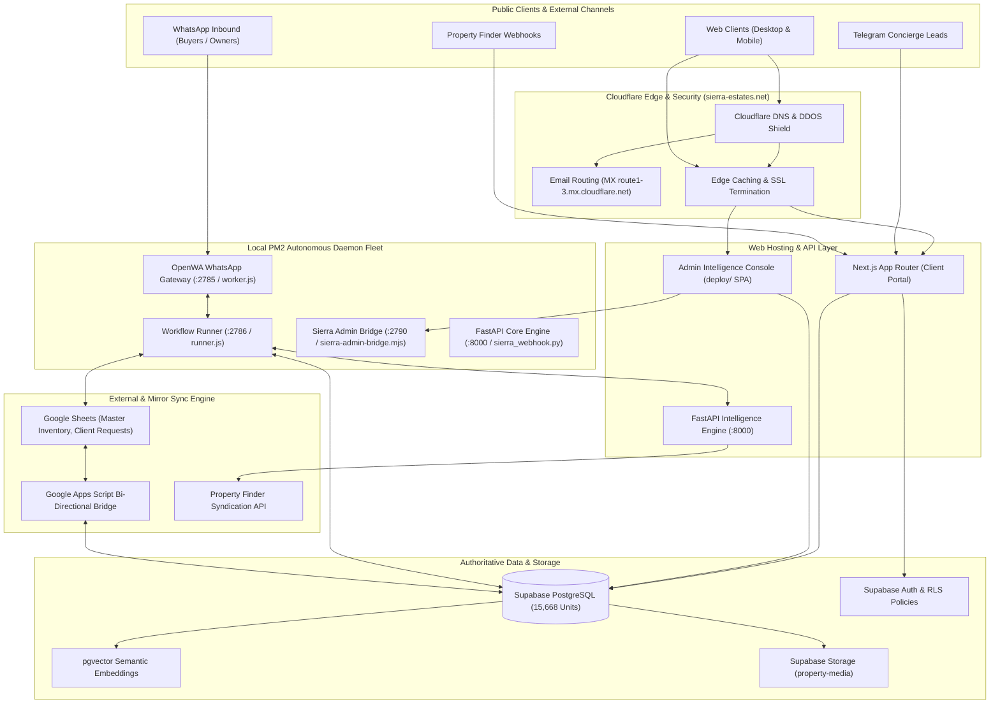
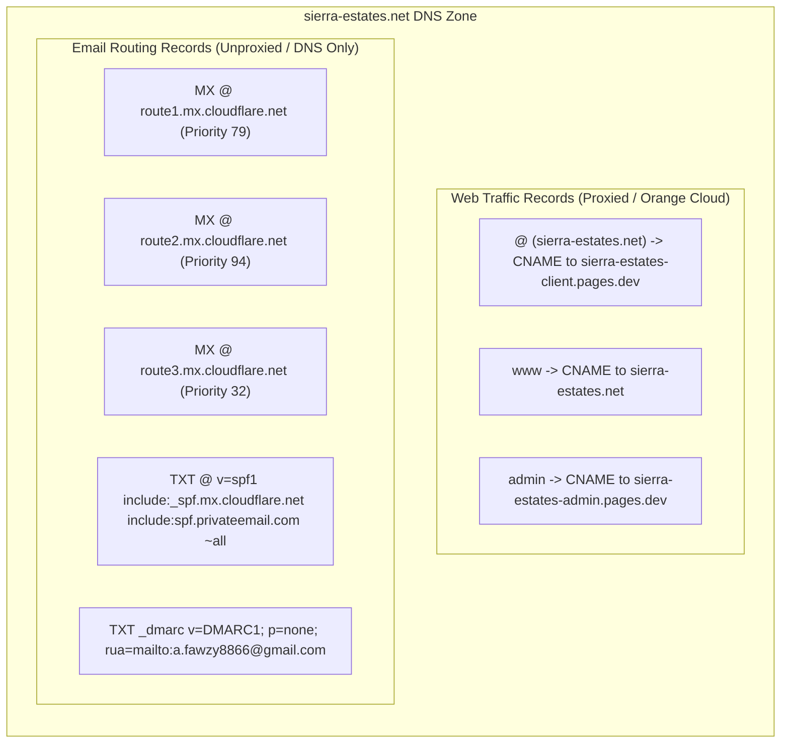
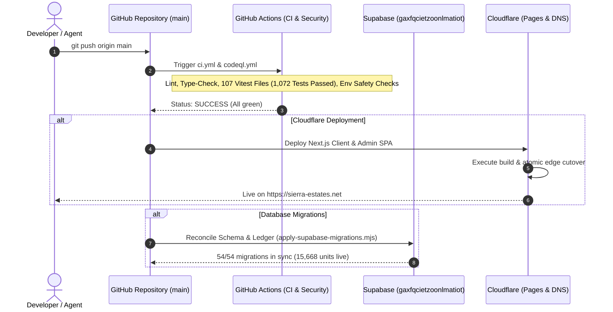

# Sierra Estates — System Architecture & Engineering Blueprint

> **System Overview:** Sierra Estates is an enterprise luxury PropTech platform and autonomous brokerage engine operating in New Cairo / East Cairo, Egypt. It unites a Next.js client & administrative portal, Cloudflare edge proxy & security, Supabase PostgreSQL with `pgvector`, Python FastAPI intelligence, Google Sheets two-way synchronization, and an autonomous multi-line WhatsApp & Telegram outreach fleet.

---

## 1. High-Level System Architecture Map



---

## 2. Ingestion, Ad-Scoring & Distribution Pipeline

```mermaid
flowchart LR
    subgraph Intake["1. Multichannel Intake"]
        RAW_WA["WhatsApp Groups / Direct Chats"]
        RAW_TG["Telegram Intake Channels"]
        RAW_FORM["Public /add-listing Web Form"]
        RAW_SHEET["Google Sheet Ingestion Tab"]
    end

    subgraph NLP["2. NLP Parsing & Canonical Coding"]
        PARSER["PropertyParserAgent (Gemini Flash & Arabic NLP)"]
        CODER["UnitCoderAgent (SE-SL/SE-RNT-AREA-SERIAL)"]
        NORM["normalizeEgyptianPhone (+20XXXXXXXXXX)"]
    end

    subgraph Deduplication["3. Validation & Dedup Engine"]
        DEDUP_GATE["Dedup Key: (Phone Last 7 + Compound + Price)"]
        COMP_MATCH["Compound Gazetteer (30+ New Cairo Aliases)"]
        CEIL_CHECK["Rental Ceiling Guard (<= 400,000 EGP/mo)"]
    end

    subgraph Storage["4. Authoritative Storage & Sync"]
        SUPA_MASTER[("Supabase public.listings (Authoritative)")]
        SHEET_MIRROR["Google Sheets Mirror (Owners_Rent_Master)"]
    end

    subgraph AI_Scoring["5. ML Quality & Ad Scoring"]
        LIGHTGBM["LightGBM / Gemini Ad Scorer"]
        PHOTO_GATE["Photo Quality Gate (>= 3 HD Images)"]
        ARBITRAGE["AVM & Price Arbitrage Estimator"]
    end

    subgraph Distribution["6. Distribution & Outreach"]
        PF_PUB["Property Finder Auto-Syndication"]
        CONCIERGE["Buyer Concierge WhatsApp Dispatch (P0_INBOUND)"]
        ADMIN_DASH["Admin Interactive GIS 4K Map"]
    end

    RAW_WA --> PARSER
    RAW_TG --> PARSER
    RAW_FORM --> PARSER
    RAW_SHEET --> PARSER

    PARSER --> NORM --> CODER
    CODER --> DEDUP_GATE --> COMP_MATCH --> CEIL_CHECK
    CEIL_CHECK --> SUPA_MASTER
    SUPA_MASTER <--> SHEET_MIRROR

    SUPA_MASTER --> LIGHTGBM --> PHOTO_GATE --> ARBITRAGE
    ARBITRAGE --> PF_PUB
    ARBITRAGE --> CONCIERGE
    SUPA_MASTER --> ADMIN_DASH
```



---

## 3. Autonomous AI Agent Fleet & Prompt Contracts

The multi-agent system executes across a 4-Stage intake and qualification funnel governed by standardized I/O contracts:

| Agent Name | Architectural Stage | Primary Role | Prompt Contract ID | Canonical Input Contract | Output Schema / Validation |
|---|---|---|---|---|---|
| **PropertyParserAgent** | Stage 1 (Intake) | Extracts structured unit data from unstructured Arabic/English chat streams | `property-parser` | `{ rawText, source?, defaultPhone? }` | `PropertyListingExtractionSchema` |
| **UnitCoderAgent** | Stage 2 (Identity) | Generates canonical `SE-<COMP>-<S\|R>-<AREA>-<SUFFIX>` codes | `unit-coder` | `{ compound, mode, areaSqm?, phone?, unitNumber? }` | `UnitCodeValidationSchema` |
| **InventoryMatcherAgent** | Stage 3 (Matchmaking) | Matches client requests against available units & computes pricing arbitrage | `inventory-matcher` | `{ requestId, zone, mode, budgetEgp, candidates }` | `InventoryMatchResultSchema` |
| **LeadQualifierAgent** | Stage 3 (Qualification) | Evaluates buyer intent (`HIGH`/`MEDIUM`/`LOW`) & drafts personalized Arabic WhatsApp greeting | `lead-qualifier` | `{ leadId, name, zone, budget }` | `LeadQualificationSchema` |
| **WhatsAppDispatcherAgent** | Stage 4 (Dispatch) | Formats public group unit updates and routes confidential owner contacts strictly to agency helpline (`01092048333`) | `owner-reply-classifier` | `{ unitCode, compound, unitType, mode, contactPhone, channelSource }` | `{ publicGroupMessage, privateAdminForward, adminRecipient: "01092048333" }` |
| **CareerEvaluatorAgent** | Stage 4 (Recruitment) | Evaluates broker/staff applications across Sales & Admin tracks (`Tier A/B/C`) | `career-evaluator` | `{ applicationId, role, experienceYears, hasVehicle, achievements }` | `CareerEvaluationSchema` |

---

## 4. Local Production Daemons (PM2 Architecture)

All autonomous daemons run on the local production node, supervised by **PM2** via [`ecosystem.config.cjs`](./ecosystem.config.cjs) with automatic restart on failure and memory caps:

| Daemon ID | Service Name | Bound Port | Process Command | Healthcheck URL | Role & Responsibilities |
|---|---|---|---|---|---|
| **0** | `sierra-workflow-runner` | `127.0.0.1:2786` | `node ./workflows/runner.js` | `http://127.0.0.1:2786/health` | Orchestrates 23 background cron workflows, handles `P0_INBOUND` lead queues, and manages scheduled digests. |
| **1** | `sierra-openwa-gateway` | `127.0.0.1:2785` | `node worker.js` | `http://127.0.0.1:2785/api/health` | Multi-line WhatsApp Chromium runtime (`line-1`..`line-8`), anti-ban rate limiting, session persistence. |
| **2** | `sierra-admin-bridge` | `127.0.0.1:2790` | `node sierra-admin-bridge.mjs` | `http://127.0.0.1:2790/health` | Bridges external webhooks to local daemons, secures admin control dashboard, enforces staff authorization. |
| **3** | `sierra-fastapi-engine` | `0.0.0.0:8000` | `python ./sierra_webhook.py` | `http://127.0.0.1:8000/health` | PropTech intelligence engine, ML ad scoring, call rejection messaging, and NLP webhook parsing. |

---

## 5. Cloudflare DNS & Email Routing Blueprint

To resolve **"DNS email DNS misconfigured"** and **"no data available"** / blocked deployment conflicts:



### Exact Record Configuration Table

| Type | Name | Content / Target | Proxy Status | Purpose |
|---|---|---|---|---|
| **CNAME** | `@` | `sierra-estates-client.pages.dev` | Proxied | Routes apex web traffic to Next.js Client Portal |
| **CNAME** | `www` | `sierra-estates.net` | Proxied | Canonical www redirection |
| **CNAME** | `admin` | `sierra-estates-admin.pages.dev` | Proxied | Routes to Admin SPA Console |
| **MX** | `@` | `route1.mx.cloudflare.net` (79) | DNS Only | Cloudflare Email Routing server 1 |
| **MX** | `@` | `route2.mx.cloudflare.net` (94) | DNS Only | Cloudflare Email Routing server 2 |
| **MX** | `@` | `route3.mx.cloudflare.net` (32) | DNS Only | Cloudflare Email Routing server 3 |
| **TXT** | `@` | `v=spf1 include:_spf.mx.cloudflare.net include:spf.privateemail.com ~all` | DNS Only | Consolidated SPF (resolves "email misconfigured") |
| **TXT** | `_dmarc` | `v=DMARC1; p=none; rua=mailto:a.fawzy8866@gmail.com` | DNS Only | DMARC domain alignment policy |

---

## 6. CI/CD & Deployment Lifecycle



---

## 7. Monorepo Structure & Package Boundaries

```text
H:\Sierra Estates/
├── apps/
│   ├── sierra-estates-realty/      # Next.js 16.4 Dual-Domain Portal (sierra-estates.net)
│   ├── easy-listing/               # Rapid listing intake micro-app
│   ├── agents/                     # Multi-line WhatsApp bot worker (:2785)
│   ├── automations/                # Scheduled background automations
│   └── whatsapp-bot/               # WhatsApp bot handlers
├── deploy/                         # Standalone HTML/JS Admin SPA (admin.sierra-estates.net)
├── packages/
│   ├── db/                         # Supabase database client & typed records
│   ├── memory-engine/              # Obsidian + ECC episodic memory engine
│   ├── agents-core/                # Agent contracts & dispatch helpers
│   ├── property-finder-api/        # Property Finder Atlas OAuth2 API connector
│   ├── deepseek-harness/           # Real-estate evaluation benchmark suite
│   └── shared/                     # Common types, schemas, and phone utilities
├── workflows/                      # 23 background workflow engines & runner.js (:2786)
├── supabase/                       # 47 SQL migrations & baseline schema
└── scripts/                        # Production verification & sync automation scripts
```

---

## 8. Security, Deduplication & Operational Invariants

1. **Owner Privacy Lock:** Owner and broker phone numbers are **strictly redacted** from public views (`public_properties_view`) and client-facing API responses. All public inquiries route exclusively to the agency concierge helpline (`+201092048333`).
2. **Phone Normalization Standard:** Every phone intake passes through `normalizeEgyptianPhone()` into the canonical 11-digit `01xxxxxxxxx` format (`+20XXXXXXXXXX`).
3. **Rental Ceiling & Arbitrage Guard:** Rental units enforce a maximum monthly ceiling of `400,000 EGP/month`. AVM estimates are computed algorithmically from compound benchmarks and never fabricated.
4. **Optimistic Locking:** Supabase uses `version_id` and atomic RPC functions (`rpc_update_unit_field`) to guarantee that concurrent Google Sheet writes never silently overwrite admin modifications.
