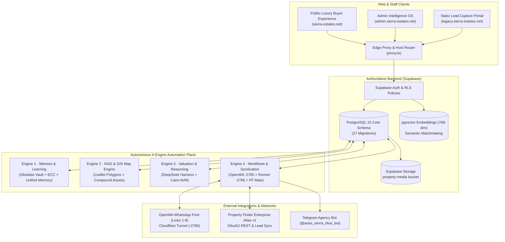

# Sierra Estates — System Architecture & Engineering Blueprint

This document is the **authoritative architectural blueprint** for Sierra Estates. It defines runtime boundaries, module ownership, component topologies, data flow patterns, and security guardrails across the platform.

Deployment protocols and release procedures are defined in [`DEPLOYMENT.md`](./DEPLOYMENT.md).

---

## 1. System Topology Overview

Sierra Estates is architected as an event-driven, decoupled system combining high-performance Next.js frontends with an autonomous 4-Engine intelligence and automation plane:



---

## 2. Monorepo Structure & Package Boundaries

The codebase is structured under **Turborepo** with strict boundary isolation between presentation, shared services, and background workers:

```text
Sierra-Estates/
├── apps/
│   ├── sierra-estates-realty/      # Next.js 16.4 Dual-Domain Application (105 routes)
│   ├── agents/                     # WhatsApp bot router & agent routing services
│   ├── api/                        # Python integration workers (Property Finder sync & bot hooks)
│   └── automations/                # Scheduled worker entry points writing through DB helpers
├── packages/
│   ├── memory-engine/              # Unified Obsidian + ECC MemoryBrainEngine RAG
│   ├── db/                         # Authoritative Supabase clients & typed records
│   ├── agents/                     # Autonomous agents (Matchmaker, Closer, Scribe)
│   ├── agents-core/                # Agent lifecycle contracts & dispatch helpers
│   ├── agents-tools/               # EpisodicContextCache & schema validators
│   ├── ai-agent-sdk/               # Shared agent runtime & tool SDK
│   ├── ai-orchestrator/            # Multi-model gateway (Google Gemini & DeepSeek)
│   ├── deepseek-harness/           # 10-scenario Egyptian real-estate benchmark suite
│   ├── exchange/                   # FX currency, gold-parity & financial arbitrage calculator
│   ├── property-finder-api/        # Property Finder Atlas v1 OAuth2 API connector
│   ├── obsidian/                   # Obsidian vault markdown parser & sync
│   ├── shared/                     # Common types, validation schemas & utilities
│   └── ui/                         # Luxury obsidian glassmorphism UI design tokens
├── workflows/                      # 10 scheduled cron workflow definitions & reply classifier
├── infra/                          # Docker Compose definitions (RAG station & workflow runner)
├── scripts/                        # Operational scripts, deployment gates & verification suites
└── supabase/                       # 27 SQL migrations, schema definitions & RLS tests
```

### Boundary Rules
1. **Thin Frontends:** `apps/sierra-estates-realty` owns HTTP request handling, server component rendering, session checks, and fast UI responses. It never executes unbounded background jobs.
2. **Worker Separation:** Long-running scraping, batch updates, WhatsApp broadcasts, and AI evaluations run exclusively in `workflows/`, `apps/automations`, or dedicated containers.
3. **Canonical DB Helper:** All server-side data mutations must pass through `packages/db` and execute the `assertCanonicalBackendForWrites()` guard.

---

## 3. The 4-Engine Revenue & Intelligence Machine

### Engine 1: Memory & Learning (`packages/memory-engine`)
* **Episodic Context Cache (ECC):** Retains multi-turn conversation context across buyer preferences and owner negotiation concessions.
* **Obsidian Knowledge Vault:** Connects domain notes on compound histories, maintenance rates, and developer reputations directly to AI prompts.
* **Unified Memory Store:** Synchronizes conversational state into `public.unified_memory` and links leads to `public.leads`.

### Engine 2: RAG & GIS Map Matching (`apps/sierra-estates-realty/app/api/inventory`)
* **Precision GIS Boundaries:** Geospatial polygons for 18 top New Cairo masterplans (Hyde Park, Mountain View iCity, Mivida, Palm Hills, Katameya Heights, etc.).
* **Verified Media Registry (`compound-real-photos.json`):** 645 verified Property Finder CDN photographic assets categorized by compound.
* **OpenClaw Photo Harvester:** Identifies 1,478 direct owner units missing photos and automatically generates compound-prioritized outreach queues.

### Engine 3: Valuation, Pricing & DeepSeek Reasoning (`packages/deepseek-harness`)
* **10-Scenario Real Estate Benchmark:** Evaluates AI responses for:
  * Accurate price/m² calculation in New Cairo submarkets.
  * Egyptian Arabic colloquial sentiment and lead intent classification.
  * Lease and sales contract clauses with local legal validity.
  * Gold-parity and FX arbitrage calculations.
* **Threshold Quality Gate (`scripts/check-thresholds.ts`):** Enforces production workflow error rates `<25%` and queue depths `<250`.

### Engine 4: Workflows, OpenClaw & Syndication (`workflows/`)
* **10 Automated Cron Workflows:** Executes sync, catalog validation, and lead alerts under `workflows/runner.js` (`:2786`).
* **OpenWA WhatsApp Pool (`:2785`):** 8 active phone lines routed via Cloudflare Tunnel, enforcing Egyptian business hours (`10:00–20:00 Africa/Cairo`) and 45–55s human-like pacing intervals.
* **Closed-Loop Reply Classifier (`workflows/lib/inbox.js`):** Classifies owner replies into Opt-Out (`إلغاء`), Available (`متاحة`), or Sold (`اتباعت`), updating `public.listings.status` automatically.
* **Property Finder Atlas v1 Syndication:** Real-time OAuth2 synchronization of listings and buyer leads between Property Finder and Supabase.

---

## 4. Request & Event Lifecycle

### A. Client Search & Discovery Flow
```text
Buyer Browser
  └─► GET https://sierra-estates.net/inventory
        └─► Edge Proxy (proxy.ts)
              └─► Next.js App Router (Server Component)
                    └─► packages/db (Supabase Query)
                          ├─► Filter: status = 'available' AND publish_status = 'PUBLISHABLE'
                          ├─► Join: public.compounds (Geospatial Polygons)
                          └─► Return: Hydrated listing cards with mode chips & GIS coords
```

### B. Inbound Owner WhatsApp Reply Flow
```text
Owner Phone (WhatsApp)
  └─► OpenWA Gateway (:2785)
        └─► POST /api/whatsapp/webhook
              └─► workflows/lib/inbox.js (Reply Classifier)
                    ├─► If 'متاحة' (Available):
                    │     ├─► UPDATE public.listings SET status = 'available'
                    │     ├─► UPSERT public.leads (Qualified Seller)
                    │     └─► Enqueue Photo Collection if photos < 3
                    ├─► If 'إلغاء' (STOP/Opt-out):
                    │     └─► APPEND .state/owner-outreach-optouts.jsonl
                    └─► If 'اتباعت' (Sold):
                          └─► UPDATE public.listings SET status = 'sold'
```

---

## 5. Security Architecture & Zero-Trust Posture

### Identity & Access Control
* **Supabase Auth:** Primary authentication boundary with Role-Based Access Control (RBAC).
* **Session Integrity:** HMAC-SHA256 signed `sierra_sess` cookie session token.
* **Failsafe Gates:** The legacy `ADMIN_BOOTSTRAP_PASSWORD` route is permanently deactivated (returns HTTP 401).

### Static Analysis & Vulnerability Remediation (120/120 Resolved)
* **OAuth 2.1 RFC 6749 §4.1.3 Compliance:** Client ID, redirect URI, and token parameters are strictly validated; access-token email extraction never accepts unverified client payloads.
* **Prototype Pollution Neutralization (CWE-1321):** Dynamic dictionary stores use `Object.create(null)` and block `__proto__`, `constructor`, and `prototype` keys.
* **Polynomial ReDoS Defense (CWE-400):** Untrusted string inputs are bounded via `.slice(0, 500)` and regular expressions eliminate overlapping optional quantifier groups.
* **TOCTOU File System Race Protection (CWE-362):** Replaced non-atomic check-then-write logic with atomic `{ flag: 'wx' }` write operations and explicit `try/catch` handlers for `ENOENT`.
* **CRLF Log Injection Defense (CWE-117):** Universal sanitization replaces newline and carriage return characters (`[\r\n]`) across all application loggers.

### Data Privacy & Owner PII Containment
* **Redaction Gate:** Public inventory exports (`GET /api/inventory/download` in CSV/XLSX format) automatically redact private owner phone numbers.
* **Concierge Masking:** All public-facing buyer contact links route to the agency helpline `+201092048333` rather than exposing direct owner numbers.

---

## 6. Decommissioned Legacy Infrastructure

The following legacy components have been completely retired from the production path:

1. **Firebase Hosting, Functions & Firestore:** Fully retired. Supabase is the sole authoritative datastore.
2. **Legacy AWS EC2 Host (`54.89.162.250`):** Replaced by the containerized Docker Runner (`:2786`) and OpenWA RAG Station (`:2785`) via Cloudflare Tunnel.
3. **Standalone Legacy Admin Repo:** Consolidated into the unified monorepo under `apps/sierra-estates-realty`.
4. **Plaintext Admin Backdoors:** Removed and locked.
