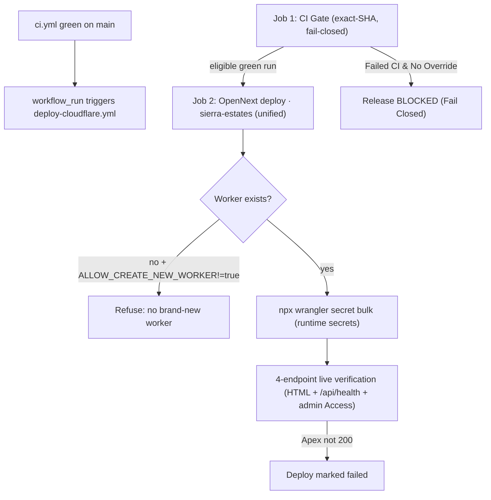

# Sierra Estates — Master Deployment & Operations Guide

This document is the **single source of truth** for all deployment, operations, and infrastructure policies across Sierra Estates. The repository operates under a strict, unified architectural contract:

- **Web Surfaces:** Hosted on a **single unified Cloudflare Worker** `sierra-estates` (2026-11-19, Lane A architecture) built with `@opennextjs/cloudflare` from `apps/sierra-estates-realty` — it serves all hostnames via Next.js host-based rewrites: `sierra-estates.net` (client portal), `www.sierra-estates.net` (edge 301 redirect), `admin.sierra-estates.net` (admin OS behind Cloudflare Access). Worker creation is strictly locked (`ALLOW_CREATE_NEW_WORKER` gate).
- **Authoritative Datastore:** **Supabase PostgreSQL** (`https://gaxfqcietzoonlmatiot.supabase.co`) with `pgvector`, Auth, Storage, and RLS.
- **Worker & Outreach Control Plane:** Local / Docker Workflow Runner (`:2786`) and OpenWA 8-Line Pool (`:2785`) connected via **Cloudflare Tunnel**.
- **Heavy / Background Processing:** Executes strictly in workers (`workflows/`, GitHub Actions, n8n), never inside user-facing Next.js request handlers.
- **Retired Infrastructure:** Legacy Firebase deployments, the legacy AWS EC2 host (`54.89.162.250`) and the **Vercel hosting pipeline** (projects, `vercel.json` configs, `deploy-vercel.yml` — disabled via API) are permanently deactivated.

---

## 1. Production Deployment Matrix

| Surface / Service | Target Host / URL | Cloudflare Worker | Runtime | Trigger / Deployment Method |
|---|---|---|---|---|
| **Client Luxury Portal** | `https://sierra-estates.net` | `sierra-estates` (unified) | Next.js 16.4 (App Router) via OpenNext | Green CI `workflow_run` / manual dispatch → `deploy-cloudflare.yml` |
| **Admin Intelligence OS** | `https://admin.sierra-estates.net` | `sierra-estates` (unified, host rewrite to `/admin` + Zero Trust Access) | Next.js 16.4 (App Router) via OpenNext | Same workflow — single worker, no separate deploy |
| **Static Portal (Fallback)** | `deploy/` directory — **hosting pending a Lane A decision** (config prepared: `deploy/wrangler.jsonc` + `deploy/_headers`; unified worker creation is locked by design) | not yet deployed | Workers Static Assets (prepared) | Manual / future Lane A wiring |
| **Authoritative Database** | Supabase Postgres | `gaxfqcietzoonlmatiot.supabase.co` | PostgreSQL 15 + pgvector | Supabase CLI & `scripts/apply-supabase-schema.mjs` (27 migrations) |
| **WhatsApp RAG Gateway** | OpenWA 8-Line Pool (`:2785`) | Container / Cloudflare Tunnel | Node.js OpenWA | `infra/docker-compose.rag-station.yml` |
| **Automation Workflow Runner** | Sierra Runner (`:2786`) | Container / Local Worker | Node.js Runner | `infra/docker-compose.runner.yml` (`workflows/runner.js`) |
| **Syndication & Scraping** | Property Finder Atlas v1 | Cloud Worker / GitHub Actions | Node / Python | `scripts/sync-propertyfinder.ts` & `.github/workflows/agent-fleet.yml` |

---

## 2. Cloudflare Configuration & Ownership

Cloudflare Workers deployments are managed through wrangler configuration files:

* **Worker Configuration:** `apps/sierra-estates-realty/wrangler.jsonc` — the single unified `sierra-estates` worker (OpenNext transform, standalone output, Durable Object queue/tag-cache bindings).
* **Deploy Workflow:** [`.github/workflows/deploy-cloudflare.yml`](./.github/workflows/deploy-cloudflare.yml) runs ONLY on a green CI `workflow_run` (or manual dispatch), verifies credentials (fails loudly on missing `CLOUDFLARE_API_TOKEN`/`CLOUDFLARE_ACCOUNT_ID`), **refuses to create a brand-new worker** unless secret `ALLOW_CREATE_NEW_WORKER=true`, deploys via `wrangler deploy`, bulk-syncs runtime secrets and runs a 4-endpoint live verification (real HTML + `/api/health` + Access on admin).
* **Static Fallback (pending):** `deploy/wrangler.jsonc` + `deploy/_headers` hold a prepared, **not yet wired** Workers Assets config for the legacy portal — enabling it is a Lane A call (second static worker vs. `public/` ingestion into the unified worker).

> [!WARNING]
> Do NOT recreate Vercel projects or re-enable `deploy-vercel.yml` — the Vercel pipeline is retired. The workflow file is kept only as a disabled, reversible reference; re-enabling it requires the Vercel secrets that have been decommissioned.
>
> The unified worker is under a strict single-project lock: `deploy-cloudflare.yml` refuses to create any brand-new Cloudflare Worker unless secret `ALLOW_CREATE_NEW_WORKER=true` is explicitly set.

---

## 3. GitHub Actions CI/CD Pipeline

The repository enforces CI-gated production releases via [`.github/workflows/deploy-cloudflare.yml`](./.github/workflows/deploy-cloudflare.yml):



### Key GitHub Secrets & Environment Variables
| Variable Name | Secret / Env | Purpose |
|---|:---:|---|
| `CLOUDFLARE_API_TOKEN` | Secret | Cloudflare API token — `Workers Scripts:Edit` (account) + `Zone DNS:Edit` (zone `sierra-estates.net`). |
| `CLOUDFLARE_ACCOUNT_ID` | Variable | Cloudflare account identifier for wrangler + domain attach. |
| `NEXT_PUBLIC_SUPABASE_URL` | Public Env | Canonical Supabase project URL (`https://gaxfqcietzoonlmatiot.supabase.co`). |
| `NEXT_PUBLIC_SUPABASE_ANON_KEY` | Public Env | Anonymous public Supabase API key for client-side reads (also build-time for both Next workers). |
| `SUPABASE_SERVICE_ROLE_KEY` | Secret | Server-only admin key for elevated mutations and RLS bypasses (synced to worker runtime). |
| `SESSION_SECRET` | Secret | HMAC-SHA256 signing secret for session cookies (synced to worker runtime). |
| `TELEGRAM_BOT_TOKEN` | Secret | Bot token for agency operations alerts (`@arias_sierra_blue_bot`). |
| `PROPERTY_FINDER_API_KEY` | Secret | Property Finder Enterprise Atlas v1 client key. |
| `PROPERTY_FINDER_API_SECRET` | Secret | Property Finder Enterprise Atlas v1 client secret. |
| `CRON_SECRET` | Secret | Bearer token authenticating `/api/cron/*` — used by the GitHub Actions scheduler, GCP Cloud Scheduler and synced to the worker runtime. |
| `GEMINI_API_KEY` / `OPENAI_API_KEY` / `DEEPSEEK_API_KEY` | Secret | LLM structured extraction, inventory matching & evaluation APIs. |
| `SHEETS_WEBAPP_URL` / `SIERRA_SECRET_KEY` | Env / Secret | Google Apps Script Web App endpoint + secret for Client_Requests, Career_Applications & Inventory sync. |
| `WHATSAPP_API_URL` / `OPENWA_ADMIN_API_KEY` / `WA_ADMIN_NUMBER` | Secret | OpenWA 8-line gateway URL, auth key & confidential admin phone (`01092048333`). |

### Startup Environment Validation (`core/env-validator.ts`)
Run `validateEnv({ strict: true })` (or inspect `GET /api/admin/prompts`) to fail fast with grouped diagnostics across all 5 service domains (`DATABASE`, `LLM_APIS`, `GOOGLE_SHEETS`, `WHATSAPP_TELEGRAM`, `DEPLOYMENT`).

---

## 4. Authoritative Datastore: Supabase Postgres

All persistent state (listings, leads, admin users, embeddings, media) resides in Supabase:

* **PostgreSQL Engine:** 27 consolidated SQL migrations in `supabase/migrations/`.
* **Spatial GIS:** Coordinates and polygon boundaries stored as GeoJSON geometry objects.
* **Vector Embeddings:** 768-dimensional `vector` columns for semantic listing matchmaker.
* **Media Storage:** Assets reside in `property-media` public storage bucket (`https://gaxfqcietzoonlmatiot.supabase.co/storage/v1/object/public/property-media/`).
* **Migrations Command:**
  ```bash
  # Apply schema and verify connection
  pnpm deploy:supabase
  # Generate vector embeddings for unindexed units
  pnpm embeddings:generate
  # Synchronize compound polygon gazetteer
  pnpm gazetteer:sync
  ```

---

## 5. Worker & Outreach Control Plane

Long-running workers run in isolated runtimes rather than Next.js request threads:

### Local & Containerized Runners
* **OpenWA 8-Line WhatsApp Gateway (`:2785`):**
  Managed via `infra/docker-compose.rag-station.yml` with a Cloudflare Tunnel sidecar (`.tunnel-url`). Supports QR code pairing and 8-character phone pairing codes.
* **Workflow Runner (`:2786`):**
  Managed via `infra/docker-compose.runner.yml`. Executes the 10 scheduled cron workflows (`workflows/01..10`).

### Scheduled GitHub Actions
* **`whatsapp-outreach.yml`:** Scheduled every 30 minutes during Cairo business hours (`10:00–20:00 Africa/Cairo`), defaulting to safe `WF_DRY_RUN=true`.
* **`agent-fleet.yml`:** Daily automated scheduled workflow executing backend policy gates, daily briefings, Property Finder sync, and threshold verification.

---

## 6. Scheduled Automation (Cron Jobs)

Scheduled jobs are **not** hosted by the web runtime — GitHub Actions drives them against the live client worker:

| Schedule (UTC) | Dispatch target | Purpose |
|---|---|---|
| `10 * * * *` (hourly) | `/api/cron/dispatch/whatsapp-dispatch` | Outbound WhatsApp automation dispatch |
| `25 */3 * * *` (3-hourly) | `/api/cron/dispatch/lead-timers` | Lead timers & availability SLA checks |
| `10 2 * * *` | `/api/cron/dispatch/night` | Night window (04:10 Cairo) — nightly automation jobs |
| `10 6 * * *` | `/api/cron/dispatch/morning` | Morning window (08:10 Cairo) — morning automation jobs |
| `10 10 * * *` | `/api/cron/dispatch/sync-leads` | Daily CRM lead re-indexing & status hygiene |

* **Mechanism:** `.github/workflows/automations.yml` calls `https://sierra-estates.net/api/cron/dispatch/<target>` with `Authorization: Bearer $CRON_SECRET` (fail-with-body; HTTP 500 signals retries, the dispatcher's dedupe guard makes retries re-run only failed jobs). GCP Cloud Scheduler (Secret Manager `cron_secret`) is the canonical scheduler per the workflow header; the GHA schedules are the always-on fallback and every job is also dispatchable manually via the workflow's matrix input.
* **Retired:** the two Vercel cron fallback windows (`45 6 * * *` / `45 2 * * *`) lived in `vercel.json` and were removed with the Vercel retirement — the dispatcher and its `automation_runs` observability/DLQ are the single scheduling contract now.

---

## 7. Operational Verification & Health Checks

Before promoting any change or deployment, execute the full verification chain:

```bash
# 1. Type-check across monorepo packages
pnpm type-check

# 2. Run Vitest suite (857 tests across 94 suites)
pnpm test:root

# 3. Check for compiled twins and legacy runtime boundaries
node scripts/check-no-compiled-twins.mjs
node scripts/check-legacy-runtime-boundary.mjs

# 4. Probe live deployment capability and SBR gate
pnpm live:status
```

---

## 8. Rollback & Emergency Incident Runbook

1. **Cloudflare Worker Instant Rollback:**
   - Via CLI: `pnpm exec wrangler rollback --name sierra-estates`, or in the Cloudflare Dashboard under **Workers & Pages → sierra-estates → Deployments (Version history)** → select the last green version → **Rollback**. Version rollbacks are atomic and instant; the next green CI run will re-deploy on top.
2. **Database State Protection:**
   - Supabase schema migrations are strictly backward-compatible. Column additions are nullable or provide default values; column drops are only performed after code deprecation.
3. **WhatsApp Outbound Kill Switch:**
   - If an anomalous messaging pattern occurs, toggle `WHATSAPP_LIVE_OUTREACH=false` in the GitHub repository settings or terminate the OpenWA gateway container (`docker compose -f infra/docker-compose.rag-station.yml down`).
