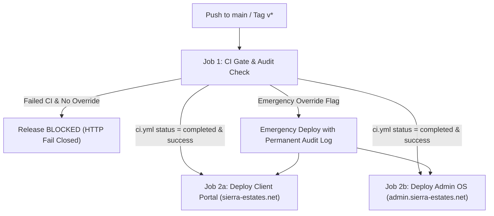

# Sierra Estates — Master Deployment & Operations Guide

This document is the **single source of truth** for all deployment, operations, and infrastructure policies across Sierra Estates. The repository operates under a strict, unified architectural contract:

- **Web Surfaces:** Hosted on **Vercel** across two distinct projects built from `apps/sierra-estates-realty`.
- **Authoritative Datastore:** **Supabase PostgreSQL** (`https://gaxfqcietzoonlmatiot.supabase.co`) with `pgvector`, Auth, Storage, and RLS.
- **Worker & Outreach Control Plane:** Local / Docker Workflow Runner (`:2786`) and OpenWA 8-Line Pool (`:2785`) connected via **Cloudflare Tunnel**.
- **Heavy / Background Processing:** Executes strictly in workers (`workflows/`, GitHub Actions, n8n), never inside user-facing Next.js request handlers.
- **Retired Infrastructure:** Legacy Firebase deployments and legacy AWS EC2 host (`54.89.162.250`) are permanently deactivated.

---

## 1. Production Deployment Matrix

| Surface / Service | Target Host / URL | Vercel Project ID / Host | Runtime | Trigger / Deployment Method |
|---|---|---|---|---|
| **Client Luxury Portal** | `https://sierra-estates.net` | `prj_ieVcIcoeTtHndspXMzlE0cwLl89c` (`sierra-estates-client-portal`) | Next.js 16.4 (App Router) | Push to `main` via Vercel GitHub integration / `deploy-vercel.yml` |
| **Admin Intelligence OS** | `https://admin.sierra-estates.net` | `prj_inhTu8kppYhQv2NZZV3GTUdU8uBi` | Next.js 16.4 (App Router) | Push to `main` via Vercel GitHub integration / `deploy-vercel.yml` |
| **Static Portal (Fallback)** | `https://legacy.sierra-estates.net` | `sierra-estates-static-portal` | Static HTML / CDN | Vercel CLI from `deploy/` directory |
| **Authoritative Database** | Supabase Postgres | `gaxfqcietzoonlmatiot.supabase.co` | PostgreSQL 15 + pgvector | Supabase CLI & `scripts/apply-supabase-schema.mjs` (27 migrations) |
| **WhatsApp RAG Gateway** | OpenWA 8-Line Pool (`:2785`) | Container / Cloudflare Tunnel | Node.js OpenWA | `infra/docker-compose.rag-station.yml` |
| **Automation Workflow Runner** | Sierra Runner (`:2786`) | Container / Local Worker | Node.js Runner | `infra/docker-compose.runner.yml` (`workflows/runner.js`) |
| **Syndication & Scraping** | Property Finder Atlas v1 | Cloud Worker / GitHub Actions | Node / Python | `scripts/sync-propertyfinder.ts` & `.github/workflows/agent-fleet.yml` |

---

## 2. Vercel Configuration & Ownership

Vercel Git deployments are managed through the root configuration:

* **Organization / Team ID:** `team_UvdJ5ezVTaqEKyhqZ5QVqOKJ`
* **Root Configuration:** [`vercel.json`](./vercel.json) specifies the root build command and ignores non-production triggers:
  ```json
  {
    "buildCommand": "bash scripts/ci-preflight.sh && pnpm --filter sierra-estates-client-page build"
  }
  ```
* **Dual Project Linking:**
  1. Root `.vercel/project.json` is bound to the Client Portal (`sierra-estates-client-portal`).
  2. The Admin surface runs as an isolated Vercel project sharing the repository with root directory configured to project root and domain routing mapped to `admin.sierra-estates.net`.

> [!WARNING]
> Do NOT set `git.deploymentEnabled: true` inside `apps/sierra-estates-realty/vercel.json`. Enabling it in the nested app config spawns an unauthorized third Vercel project. Keep git deployment settings strictly at the repository root.

---

## 3. GitHub Actions CI/CD Pipeline

The repository enforces CI-gated production releases via [`.github/workflows/deploy-vercel.yml`](./.github/workflows/deploy-vercel.yml):



### Key GitHub Secrets & Environment Variables
| Variable Name | Secret / Env | Purpose |
|---|:---:|---|
| `VERCEL_TOKEN` | Secret | Vercel API authorization token for automated deployment. |
| `VERCEL_ORG_ID` | Secret | Vercel team identifier (`team_UvdJ5ezVTaqEKyhqZ5QVqOKJ`). |
| `CLIENT_VERCEL_PROJECT_ID` | Secret | Client project ID (`prj_ieVcIcoeTtHndspXMzlE0cwLl89c`). |
| `ADMIN_VERCEL_PROJECT_ID` | Secret | Admin project ID (`prj_inhTu8kppYhQv2NZZV3GTUdU8uBi`). |
| `NEXT_PUBLIC_SUPABASE_URL` | Public Env | Canonical Supabase project URL (`https://gaxfqcietzoonlmatiot.supabase.co`). |
| `NEXT_PUBLIC_SUPABASE_ANON_KEY` | Public Env | Anonymous public Supabase API key for client-side reads. |
| `SUPABASE_SERVICE_ROLE_KEY` | Secret | Server-only admin key for elevated mutations and RLS bypasses. |
| `SESSION_SECRET` | Secret | HMAC-SHA256 signing secret for session cookies. |
| `TELEGRAM_BOT_TOKEN` | Secret | Bot token for agency operations alerts (`@arias_sierra_blue_bot`). |
| `PROPERTY_FINDER_API_KEY` | Secret | Property Finder Enterprise Atlas v1 client key. |
| `PROPERTY_FINDER_API_SECRET` | Secret | Property Finder Enterprise Atlas v1 client secret. |

---

## 4. Authoritative Datastore: Supabase Postgres

All persistent state (listings, leads, admin users, embeddings, media) resides in Supabase:

* **PostgreSQL Engine:** 27 consolidated SQL migrations in `supabase/migrations/`.
* **Spatial GIS:** Coordinates and polygon boundaries stored as GeoJSON geometry objects.
* **Vector Embeddings:** 768-dimensional `vector` columns for semantic listing matchmaker.
* **Media Storage:** Assets reside in `property-media` public storage bucket (`https://gaxfqcietzoonlmatiot.supabase.co/storage/v1/object/public/property-media/`).
* **Migrations Command:**
  ```bash
  # Apply schema and verify connection
  pnpm deploy:supabase
  # Generate vector embeddings for unindexed units
  pnpm embeddings:generate
  # Synchronize compound polygon gazetteer
  pnpm gazetteer:sync
  ```

---

## 5. Worker & Outreach Control Plane

Long-running workers run in isolated runtimes rather than Next.js request threads:

### Local & Containerized Runners
* **OpenWA 8-Line WhatsApp Gateway (`:2785`):**
  Managed via `infra/docker-compose.rag-station.yml` with a Cloudflare Tunnel sidecar (`.tunnel-url`). Supports QR code pairing and 8-character phone pairing codes.
* **Workflow Runner (`:2786`):**
  Managed via `infra/docker-compose.runner.yml`. Executes the 10 scheduled cron workflows (`workflows/01..10`).

### Scheduled GitHub Actions
* **`whatsapp-outreach.yml`:** Scheduled every 30 minutes during Cairo business hours (`10:00–20:00 Africa/Cairo`), defaulting to safe `WF_DRY_RUN=true`.
* **`agent-fleet.yml`:** Daily automated scheduled workflow executing backend policy gates, daily briefings, Property Finder sync, and threshold verification.

---

## 6. Scheduled Vercel Functions (Cron Jobs)

Vercel functions handle lightweight periodic synchronization:

| Schedule (UTC) | Path | Purpose |
|---|---|---|
| `0 0 * * *` | `/api/cron/sync-leads` | Daily CRM lead re-indexing & status hygiene |
| `0 6 * * *` | `/api/cron/sync-listings` | Property catalog sync and price change detection |
| `30 6 * * *` | `/api/cron/sync-master-sheet` | Syncs Google Sheets master inventory |
| `0 2 * * *` | `/api/cron/expire-reservations` | Cleans expired buyer reservation locks |
| `0 3 * * *` | `/api/cron/apply-migrations` | Verifies and applies pending SQL schema migrations |

---

## 7. Operational Verification & Health Checks

Before promoting any change or deployment, execute the full verification chain:

```bash
# 1. Type-check across monorepo packages
pnpm type-check

# 2. Run Vitest suite (857 tests across 94 suites)
pnpm test:root

# 3. Check for compiled twins and legacy runtime boundaries
node scripts/check-no-compiled-twins.mjs
node scripts/check-legacy-runtime-boundary.mjs

# 4. Probe live deployment capability and SBR gate
pnpm live:status
```

---

## 8. Rollback & Emergency Incident Runbook

1. **Vercel Instant Rollback:**
   - In the Vercel Dashboard for `sierra-estates-client-portal` or `admin`, navigate to **Deployments** → Select the last green deployment → Click **Promote to Production**.
2. **Database State Protection:**
   - Supabase schema migrations are strictly backward-compatible. Column additions are nullable or provide default values; column drops are only performed after code deprecation.
3. **WhatsApp Outbound Kill Switch:**
   - If an anomalous messaging pattern occurs, toggle `WHATSAPP_LIVE_OUTREACH=false` in the GitHub repository settings or terminate the OpenWA gateway container (`docker compose -f infra/docker-compose.rag-station.yml down`).
