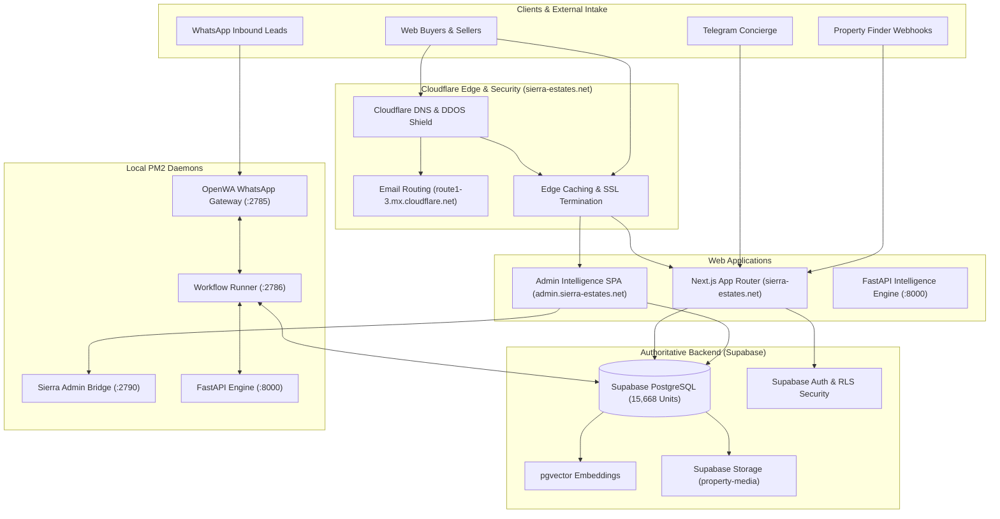
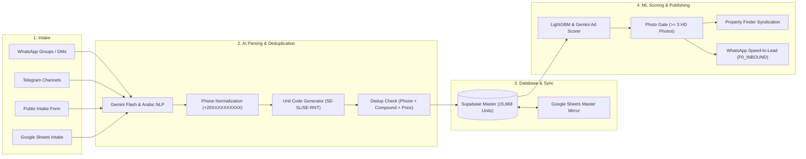

# Sierra Estates Realty — Enterprise AI PropTech Platform

[](https://nextjs.org/)
[](https://turbo.build/)
[](https://www.typescriptlang.org/)
[](https://dash.cloudflare.com/)
[-3ECF8E?style=flat&logo=supabase)](https://supabase.com/)
[-brightgreen)](https://github.com/afawzy886619888866-cloud/Sierra-Estates)
[-emerald)](./ecosystem.config.cjs)

> **Sierra Estates** is an enterprise luxury PropTech platform and autonomous brokerage engine operating in **New Cairo / East Cairo, Egypt**. It unites a high-performance Next.js buyer portal, an interactive administrative intelligence suite, Cloudflare edge routing, Supabase PostgreSQL with `pgvector`, Python FastAPI intelligence, Google Sheets two-way synchronization, and an autonomous multi-line WhatsApp & Telegram outreach fleet.

---

## 🗺️ System Architecture



---

## ⚡ Multi-Channel Ingestion & Syndication Pipeline



---

## 🖥️ Live Production Surfaces & Daemon Matrix

### Web Surfaces (Cloudflare & Supabase)

| Surface | Public URL | Engine / Architecture | Status |
|---|---|---|:---:|
| **Client Luxury Portal** | [sierra-estates.net](https://sierra-estates.net) | Next.js 16.4 App Router (React 19, Tailwind CSS) | 🟢 Configured |
| **Admin Intelligence Console** | [admin.sierra-estates.net](https://admin.sierra-estates.net) | Standalone Executive HTML5/JS Dashboard (`deploy/`) | 🟢 Configured |
| **Supabase Authoritative DB** | `gaxfqcietzoonlmatiot.supabase.co` | PostgreSQL 15, `pgvector`, Auth, Storage (15,668 units) | 🟢 Live |

### Local Production Daemons (PM2 Supervised)

All background services are supervised locally via PM2 ([`ecosystem.config.cjs`](./ecosystem.config.cjs)) with automatic restart and health monitoring:

| Port | Service Name | Entrypoint | Healthcheck Endpoint | Status |
|:---:|---|---|---|:---:|
| **`:8000`** | `sierra-fastapi-engine` | `python ./sierra_webhook.py` | `http://127.0.0.1:8000/health` | 🟢 Online |
| **`:2785`** | `sierra-openwa-gateway` | `node ./apps/agents/whatsapp-multi-session/worker.js` | `http://127.0.0.1:2785/api/health` | 🟢 Online |
| **`:2786`** | `sierra-workflow-runner` | `node ./workflows/runner.js` | `http://127.0.0.1:2786/health` | 🟢 Online |
| **`:2790`** | `sierra-admin-bridge` | `node ./workflows/sierra-admin-bridge.mjs` | `http://127.0.0.1:2790/health` | 🟢 Online |

---

## 🔒 Critical System Invariants

1. **Owner Privacy Lock:** Owner and broker phone numbers are **strictly redacted** from public views (`public_properties_view`) and client-facing API responses. All public inquiries route exclusively to the agency concierge helpline (`+201092048333`).
2. **Supabase is Authoritative:** Supabase PostgreSQL is the single source of truth for inventory, client requests, and lead states. Google Sheets are mirrors.
3. **Canonical Phone & Unit Deduplication:** All Egyptian mobile numbers must pass through `normalizeEgyptianPhone()` into the canonical 11-digit `01xxxxxxxxx` format (`+20XXXXXXXXXX`). Units receive deterministic canonical codes (`SE-SL/SE-RNT-[AREA]-[SERIAL]`).
4. **Rent Ceiling & AVM Guard:** Rental units enforce a maximum monthly ceiling of `400,000 EGP/month`. AVM estimates are computed algorithmically from compound benchmarks and never fabricated.
5. **No Silent Failures:** All side effects (Google Sheets, Telegram notifications, Supabase RPC calls) report explicit boolean success and error payloads.

---

## 🛠️ Verification & Developer Quickstart

```bash
# 1. Check local daemon status
npx pm2 status

# 2. Run repository safety boundary checks
node scripts/check-no-compiled-twins.mjs
node scripts/check-legacy-runtime-boundary.mjs
node scripts/check-public-env-safety.mjs

# 3. Execute Vitest test suite (107 files / 1,072 tests)
pnpm vitest run

# 4. Next.js type check
pnpm --filter sierra-estates-client-page type-check
```

---

## 📚 Core Technical Documentation

- **[Architecture Blueprint (`ARCHITECTURE.md`)](./ARCHITECTURE.md):** In-depth system design, data models, package boundaries, and sequence diagrams.
- **[Cloudflare Setup & DNS Guide (`docs/deployment/cloudflare-setup.md`)](./docs/deployment/cloudflare-setup.md):** Step-by-step custom domain and Cloudflare Email Routing configuration.
- **[Deployment Manual (`DEPLOYMENT.md`)](./DEPLOYMENT.md):** Release procedures, environment hygiene, and operational runbooks.
