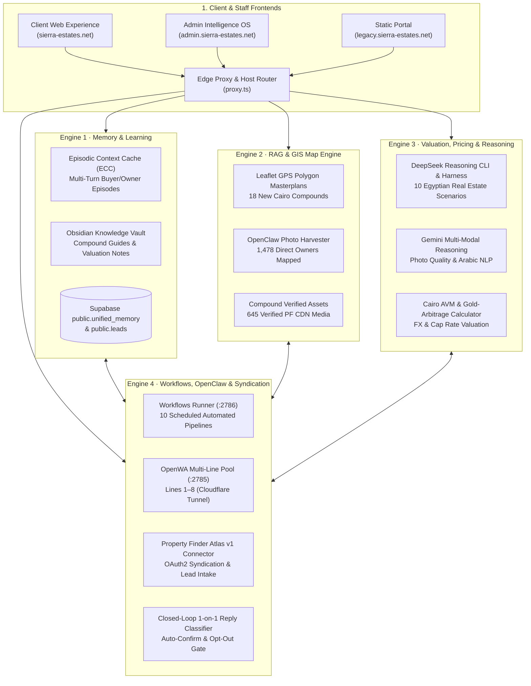
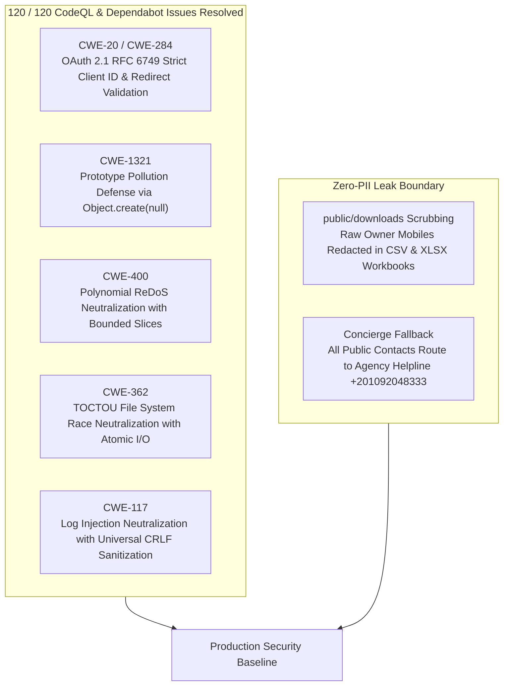

# Sierra Estates Realty — Enterprise AI PropTech Platform

[](https://nextjs.org/)
[](https://turbo.build/)
[](https://www.typescriptlang.org/)
[](https://supabase.com/)
[-brightgreen)](https://github.com/afawzy886619888866-cloud/Sierra-Estates)
[](https://sierra-estates.net)
[](https://github.com/afawzy886619888866-cloud/Sierra-Estates)
[](https://sierra-estates.net)
<!-- markdownlint-disable-next-line MD051 -->
[](#license--maintainers)

> **Sierra Estates Realty** is the premier enterprise luxury PropTech intelligence platform engineered for the Egyptian luxury property market (**New Cairo / Fifth Settlement**). It unites client property discovery, algorithmic valuation, automated WhatsApp & Telegram lead concierges, interactive spatial masterplan maps, and an autonomous multi-agent fleet grounded by a unified **Obsidian + ECC Memory Brain Engine** and a **4-Engine Revenue Machine**.

---

## 🧭 Executive Summary & Living Master Guide

This repository serves as the single source of truth for the Sierra Estates engineering, architecture, and business intelligence platform.

* **Primary Active Repository:** [https://github.com/afawzy886619888866-cloud/Sierra-Estates](https://github.com/afawzy886619888866-cloud/Sierra-Estates)
* **Authoritative Backend:** Supabase PostgreSQL (`gaxfqcietzoonlmatiot.supabase.co`) with `pgvector`, Auth, Storage, and RLS.
* **Core Market Focus:** Cairo, Egypt — Golden Square, Fifth Settlement, New Cairo, and New Administrative Capital luxury compounds.
* **Current Operational Health:** Clean `origin/main`, 94 test suites (857 tests, 100% pass rate), 120/120 CodeQL/Dependabot security issues resolved, zero merge conflicts, zero PII leaks.

---

## 🌐 Live Deployments & Surfaces Matrix

Four production environments are live and operational. Every commit to `main` executes pre-flight checks and triggers automated builds via Vercel:

| # | Application Surface | Public URL | Runtime / Framework | Status | Deployment Target |
|:---:|---|---|---|:---:|---|
| **1** | **Client Luxury Web Portal** | <https://sierra-estates.net> | Next.js 16.4 (App Router) | ✅ HTTP 200 | Vercel Project `prj_ieVcIcoeTtHndspXMzlE0cwLl89c` |
| **2** | **Admin Intelligence OS** | <https://admin.sierra-estates.net> | Next.js 16.4 (App Router) | ✅ HTTP 200 | Vercel Project `prj_inhTu8kppYhQv2NZZV3GTUdU8uBi` |
| **3** | **Static Portal (Fast Fallback)** | <https://sierra-estates-static-portal.vercel.app> | Static HTML / Vanilla JS | ✅ HTTP 200 | Vercel CLI (`deploy/`) |
| **4** | **Legacy Subdomain** | <https://legacy.sierra-estates.net> | Static HTML / CDN | ✅ HTTP 200 | CNAME → `cname.vercel-dns.com` |

> [!NOTE]
> All Vercel deployments enforce `ssoProtection: all_except_custom_domains`. Production custom domains are open to public buyers/staff, while ephemeral `*.vercel.app` preview deployments require authenticated team access.

---

## 🏛️ System Architecture: The Unified 4-Engine Machine

The platform runs as a high-performance **Turborepo** monorepo featuring a dual-domain Next.js 16 deployment backed by Supabase PostgreSQL and governed by the **4-Engine Revenue Architecture**:



---

## 💎 Core Surface Deep Dives

### 1. Client Web Portal (`sierra-estates.net`)

Engineered for ultra-high-net-worth property buyers and investors seeking prime New Cairo residential and commercial assets:

* **Obsidian Glassmorphism & High-Contrast Typography:**
  * Background palette: Deep Obsidian (`rgba(6, 17, 34, 0.90)` with `backdrop-filter: blur(20px)`).
  * Typography: **Plus Jakarta Sans** and **Inter** with high-contrast text (`rgba(255, 255, 255, 0.88)`), accented by emerald/gold luxury indicators.
  * Mobile and desktop responsive layouts with accessible contrast and claymorphism glass cards.
* **Dual-Engine Interactive Spatial GIS Map:**
  * Toggle effortlessly between **4K Masterplan Visualizer** and **Live High-Precision Geographic GIS Map**.
  * Renders exact GPS bounding polygons for all 18 top New Cairo masterplans (Hyde Park, Mountain View iCity, Mivida, Palm Hills, Katameya Heights, Eastown, Villette, Swan Lake, etc.).
  * Clustered inventory pins with mode chips (Rent / Resale / Primary), price badges, and centroid spiral offsets.
  * Direct synchronization with unit detail modals, floorplans, and WhatsApp inquiry launchers.
* **Financial Intelligence & Calculators:**
  * Real-time Egyptian Pound (EGP) ROI yield estimators, installment schedules, cash-discount vs. payment-plan comparisons, and gold-parity pricing index.
* **Easy Listing Portal (`/list-property`):**
  * Direct client & owner intake workflow with client-side image preview, instant Supabase storage upload, automated AI valuation & urgency scoring, and automated Telegram alert dispatch to agency brokers.
* **Bilingual Search & Discovery:**
  * Native Arabic (`Cairo` font) and English localization supporting compound name aliases, transliterations, and colloquial Egyptian real estate terms.

---

### 2. Admin Intelligence OS (`admin.sierra-estates.net`)

The central nervous system for agency leadership, acquisition brokers, and deal closers:

* **Supabase RBAC & Session Security:**
  * Authenticated through Supabase Auth (`ahmed.fawzy@sierra-estates.net`, `farida@sierra-estates.net`, `admin-real@sierra-estates.net`).
  * HMAC-SHA256 signed `sierra_sess` cookie session guard.
  * Legacy plaintext `ADMIN_BOOTSTRAP_PASSWORD` permanently removed (fails closed with HTTP 401).
* **Live Inventory Master Governance:**
  * Real-time grid of all active catalog listings (`20,281` total, `12,913` publishable, `5,067` direct owner units).
  * In-line price adjustments, publish status toggle (`PUBLISHABLE`, `DRAFT`, `QUARANTINE`), and compound re-assignment.
* **Direct WhatsApp Stealth Sender Workstation:**
  * Operator workstation enabling direct 1-on-1 outreach from verified OpenWA phone lines (`line-1` through `line-8`) with automated typing simulation, human pacing intervals (45–55s), and dynamic missing-field templates.
* **Closed-Loop Owner Negotiation & Availability Tracker:**
  * Real-time tracking of owner replies: Available (`متاحة`), Sold (`اتباعت`), Opt-Out (`إلغاء`), and Price Adjustment.
  * Automated transition of verified units into the active buyer-matching pipeline.
* **CRM Lead Pipeline & Stage-9 Deal Closer:**
  * Tracks multi-stage buyer journeys from WhatsApp intake, VIP concierge handoff, viewing scheduling, and digital contract generation.

---

## ⚙️ The 4-Engine Machine in Detail

### Engine 1 · Memory & Learning (`packages/memory-engine`)
* **Episodic Context Cache (ECC):** Retains multi-turn conversation context across buyer inquiries and owner negotiation sessions.
* **Obsidian Knowledge Vault (`docs/obsidian-vault/`):** Scans domain markdown notes containing compound developer reputations, maintenance fees, and historical price drops.
* **Entity Graph Memory:** Maps connections between property owners, multiple owned units, buyer preferences, and previous offer concessions.
* **Supabase Synchronization:** Persists long-term agent state into `public.unified_memory` and `public.leads`.

### Engine 2 · RAG & GIS Map Engine (`apps/sierra-estates-realty/app/api/inventory`)
* **Spatial Polygon Boundaries:** Coordinates for 18 primary compounds with subfeature layers (Crystal Lagoons, Golf Courses, Green Spines, Clubhouses).
* **Verified Media Registry (`compound-real-photos.json`):** 645 verified high-resolution Property Finder CDN assets matched to compounds.
* **Photo Harvester (`scripts/openclaw-task-runner.ts`):** Ranks and prioritizes 1,478 direct owner units missing photos, queueing WhatsApp photo-collection requests automatically.

### Engine 3 · Valuation, Pricing & DeepSeek Reasoning (`packages/deepseek-harness`)
* **10-Scenario Benchmark Suite:** Offline and live reasoning harness evaluating:
  1. New Cairo Automated Valuation Model (AVM) price/m² calculation.
  2. Arabic lead intent classification (Urgent buyer vs. Window shopper).
  3. Egyptian real estate contract terms & penalty validation.
  4. Currency & Gold-parity arbitrage analysis.
  5. Distressed seller negotiation strategy.
* **Operational Latency & Error Gate (`scripts/check-thresholds.ts`):** Continuously validates that workflow error rates remain `<25%` and queue depth remains `<250`.

### Engine 4 · Workflows, OpenClaw & Syndication (`workflows/`)
* **Containerized Control Plane (`:2786`):** Governs 10 automated cron workflows for sync, scraping, price indexing, and lead distribution.
* **OpenWA WhatsApp Gateway (`:2785`):** 8-session WhatsApp pool exposed securely via Cloudflare Tunnel (`.tunnel-url`), operating strictly within Egyptian business hours (`10:00–20:00 Africa/Cairo`).
* **Property Finder Enterprise Atlas v1 (`packages/property-finder-api`):**
  * Live OAuth2 integration (`https://atlas.propertyfinder.com/v1`).
  * Automated catalog syndication via `/v1/listings` and `/api/feeds/property-finder`.
  * Inbound lead ingestion from Property Finder directly into Supabase CRM.

---

## 🤖 Model Context Protocol (MCP) Server Fleet

Sierra Estates exposes 5 dedicated MCP servers with 11 tools protected by **OAuth 2.1 with PKCE** (`RFC 7591 / RFC 7636`):

| Server Name | Exposed Tools | Description |
|---|---|---|
| `sierra-deals` | `create_pipeline_entry`, `update_pipeline_status`, `get_pipeline_summary` | Manages real estate deal pipelines and transaction milestones. |
| `stripe-payments` | `create_payment_intent`, `verify_payment`, `calculate_split` | Handles reservation deposits, escrow splits, and verification. |
| `docusign-signing`| `initiate_envelope`, `get_signature_status`, `generate_agreement` | Generates bilingual Egyptian purchase & lease agreements for e-signature. |
| `whatsapp-messaging`| `send_message`, `send_document` | Sends paced notifications and PDF tear-sheets through OpenWA. |
| `stage-9-orchestration`| Multi-party negotiation engine | Coordinates buyer-seller concession bargaining and agreement locking. |

---

## 🗄️ Authoritative Database Schema & Topology

All state is persisted exclusively in **Supabase PostgreSQL** (`gaxfqcietzoonlmatiot.supabase.co`) across **27 SQL migrations**:

* **`public.listings`**: Core catalog table holding 20,281 listings, geospatial point coordinates, compound IDs, pricing, installment plans, and photo arrays.
* **`public.compounds`**: 18 top New Cairo masterplans with GPS bounding polygons, developer info, and amenities.
* **`public.leads`**: CRM buyer and owner leads with intent scores, WhatsApp interaction logs, and assigned brokers.
* **`public.owner_outreach_log`**: Audit log of all automated and manual owner WhatsApp contact attempts, enforcing rate limits and opt-outs.
* **`public.unified_memory`**: Long-term agent memory key-value store with semantic vector embeddings.
* **`public.whatsapp_queue`**: FIFO paced outbound messaging queue with exponential backoff.
* **`storage.buckets.property-media`**: Public media bucket for verified property photography, virtual tour frames, and brochures.

---

## 🛡️ Enterprise Security, Quality & CodeQL Status

Sierra Estates enforces strict static analysis, secret safety, and zero-trust policies:



* **CodeQL & Dependabot:** **120 of 120 security issues repaired and verified clean.**
* **Test Suite Verification:** **94 test files passed (100%), 857 unit & integration tests passed** via Vitest in 14.9s.
* **Owner Privacy Gate:** All public exports (`GET /api/inventory/download`) redact raw owner mobile numbers and enforce agency concierge routing.
* **Zero Merge Conflicts:** Git repository contains zero merge conflict markers across all packages.

---

## 🚀 Living Project Roadmap & Next Steps

Based on our recent milestone completions (`MAP-010`, `HARV-030`, `AUTO-040`, `SYNC-050`, `AUTO-060`), the active and upcoming priorities are:

### Active Milestone: M12 — Realtime Voice Briefings & Video Tours
- [ ] **WebRTC Realtime Audio Briefings:** Integration of Gemini Live API / WebRTC for live voice walkthroughs of New Cairo investment portfolios.
- [ ] **Automated Video Tour Synthesis:** Generation of branded 30-second property teaser reels from high-res unit photos for TikTok, Instagram Reels, and WhatsApp Status.

### Planned Enhancements & Engineering Goals
1. **Photo Harvest Acceleration:** Execute the OpenClaw photo harvesting loop across the remaining `1,478` direct owner units with missing photos.
2. **Gazetteer Expansion:** Expand precision GIS GPS bounding polygons from the current 18 compounds to 35+ masterplans across New Cairo, Mostakbal City, and the New Administrative Capital.
3. **Property Finder Atlas v1 Two-Way Sync:** Scale live syndicated ads from 311 to 1,000+ top-tier units using the automated ad selector engine.
4. **Autonomous Offer Closer:** Enhance Stage-9 closer bots to draft bilingual preliminary purchase contracts directly in DocuSign upon owner agreement.

---

## 🛠️ Developer & Operator Runbook

### Prerequisites
* Node.js 22 LTS
* `pnpm` 9.15.4 (`corepack enable pnpm`)
* Python 3.11+ (for worker & CLI scripts)
* Docker Desktop (for local workflow runner & OpenWA station)

### Quickstart
```bash
# 1. Clone repository
git clone https://github.com/afawzy886619888866-cloud/Sierra-Estates.git
cd Sierra-Estates

# 2. Install dependencies across monorepo
pnpm install

# 3. Verify TypeScript and test suites
pnpm type-check
pnpm test:root

# 4. Start local development server (Client & Admin)
pnpm dev
# Client Portal: http://localhost:3000
# Admin Surface: http://localhost:3000/admin (or admin.localhost:3000)
```

### Essential CLI Commands
| Command | Description |
|---|---|
| `pnpm build` | Production build across Turborepo with inventory snapshot sync. |
| `pnpm test:root` | Runs the full Vitest suite (94 files, 857 tests). |
| `pnpm live:status` | Performs live capability and health probe against production. |
| `pnpm automation:cycle` | Executes the 4-engine automation loop (harvester + sync + harness). |
| `pnpm export:propertyfinder`| Generates Property Finder XML/CSV feed exports. |
| `pnpm pf:publish:owners` | Exports Direct Owner publishable listings for syndication. |
| `pnpm gazetteer:sync` | Synchronizes compound GPS polygons with Supabase. |
| `pnpm embeddings:generate` | Generates 768-dimensional pgvector embeddings for listings. |

---

## 📄 License & Maintainers

- **Lead Engineer & Architect:** Ahmed Fawzy ([a.fawzy8866@gmail.com](mailto:a.fawzy8866@gmail.com))
- **Organization:** Sierra Estates Realty
- **Authoritative Repository:** [https://github.com/afawzy886619888866-cloud/Sierra-Estates](https://github.com/afawzy886619888866-cloud/Sierra-Estates)
- **Proprietary & Confidential:** All rights reserved.
