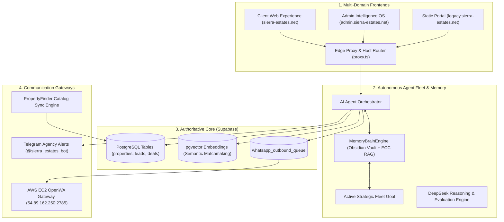

# Sierra Estates Realty — Enterprise AI PropTech Platform

[](https://nextjs.org/)
[](https://turbo.build/)
[](https://www.typescriptlang.org/)
[](https://supabase.com/)
[-brightgreen)](https://github.com/sierrablue8866-droid/SE-Vercel-deploy-main)
[](https://sierra-estates.net)
[](https://sierra-estates.net)
<!-- markdownlint-disable-next-line MD051 -->
[](#license--maintainers)

> **Sierra Estates Realty** is the premier enterprise luxury PropTech intelligence platform engineered for the Egyptian luxury property market (New Cairo / Fifth Settlement). It unites client property discovery, algorithmic valuation, automated WhatsApp & Telegram lead concierges, interactive spatial masterplan maps, and an autonomous multi-agent fleet grounded by a unified **Obsidian + ECC Memory Brain Engine**.

---

## 🌐 Live Deployments

Four production deployments are live and verified end-to-end. Every `git push` to `main` triggers an automatic rebuild on the two Next.js projects via Vercel's GitHub integration.

| # | App | URL | Framework | Status | Linked Repo |
|---|---|---|---|---|---|
| 1 | **Client Portal** | <https://sierra-estates.net> | Next.js 16.4 | ✅ HTTP 200 | `sierrablue8866-droid/SE-Vercel-deploy-main` |
| 2 | **Admin Intelligence OS** | <https://admin.sierra-estates.net> | Next.js 16.4 | ✅ HTTP 200 | `sierrablue8866-droid/SE-Vercel-deploy-main` |
| 3 | **Static Portal** (HTML) | <https://sierra-estates-static-portal.vercel.app> | Static | ✅ HTTP 200 | — (CLI-deployed from `deploy/`) |
| 4 | **Legacy Subdomain** | <https://legacy.sierra-estates.net> | Static | ✅ HTTP 200 | — (CNAME → `cname.vercel-dns.com`) |

### Deployment protection

All Vercel projects use `ssoProtection: all_except_custom_domains` — custom domains (the 4 URLs above) are publicly accessible; ephemeral `*.vercel.app` URLs require Vercel Authentication.

### Auto-deploy pipeline

GitHub `main` → Vercel build (`pnpm install` + `pnpm --filter sierra-estates-client-page build`) → production deployment → alias assigned → live in ~2 min. The two Next.js projects share the same repo; pushes rebuild both.

### Vercel webhook → Telegram alerting

Failed deployments alert the team Telegram channel via `POST /api/webhooks/vercel-deploy` (auth via `VERCEL_DEPLOY_WEBHOOK_SECRET` shared-secret). Two webhooks are registered — one per project — covering `deployment.created` and `deployment.error` events.

---

## 🏛️ System Architecture

The platform operates as a high-performance **Turborepo** monorepo featuring a dual-domain Next.js 16 deployment backed by Supabase PostgreSQL:

- **Client Web Portal** — High-polish luxury buyer experience featuring deep obsidian glassmorphism, high-contrast Plus Jakarta Sans typography, interactive Leaflet spatial masterplan map with GPS polygon boundaries, 3D virtual tours, real-time ROI/installment calculators, AI investment teasers, multilingual search (Arabic/English), and Easy Listing intake.
- **Admin Intelligence OS** — Full-featured operational command deck with RBAC session guards, live master inventory governance, owner negotiation tracking, CRM pipelines, agent hubs, and automated WhatsApp outreach queues.
- **Static Portal** — Lightweight HTML/JS lead-capture site (no build step). Served as the legacy fallback at `legacy.sierra-estates.net` for clients with slower connections.



---

## ⚡ Core Platform Pillars

### 1. High-End Luxury UI & Contrast Typography

- **Header Navigation:** Deep obsidian glassmorphism (`rgba(6, 17, 34, 0.90)` with `backdrop-filter: blur(20px)`). Menu links render in luminous high-contrast text (`rgba(255, 255, 255, 0.88)`) using **Plus Jakarta Sans**, with glowing cyan/gold active pills.
- **Hero Search & Filter Card:** Refined obsidian glass container with high-contrast ice-blue labels (`#93c5fd`, 800-weight), custom dark glass select dropdowns with SVG chevrons, and elevated Search + Listing Net action buttons.
- **Admin Dashboard Typography:** Unified **Plus Jakarta Sans / Inter** typography stack across all admin metrics, tables, headers, and form inputs, with full bilingual **Cairo** support for Arabic.

### 2. Unified Memory Brain Engine (`@sierra-estates/memory-engine`)

Fuses the **Obsidian Knowledge Vault** (`docs/obsidian-vault/`) and the **Episodic Context Cache (ECC)** into a shared RAG service. It scans domain markdown notes (compound guides, financial cap rates) and synchronizes with real-time entity profiles, historical price reductions, and distressed deal alerts to guide all fleet agents toward a shared strategic goal.

### 3. Spatial Intelligence Masterplan Engine

Interactive Leaflet map featuring precision GPS bounding polygons and subfeatures (Crystal Lagoons, Green Spines, Clubhouses, Championship Golf Courses) across all top New Cairo masterplans (Hyde Park, Mountain View iCity, Mivida, Palm Hills, Katameya Heights, etc.).

### 4. Automated WhatsApp Concierge & Owner Outreach

Hosted on a dedicated AWS EC2 instance (`54.89.162.250:2785`) with dual pairing options (Live QR scan portal + 8-character phone pairing code). Strictly enforces the 12:00 PM – 8:00 PM Africa/Cairo operational window with a 40 contact/hour rate limit, zero-drift alignment, and strict masking of private owner phone numbers (falling back to agency helpline `+201092048333`).

### 5. Easy Listing Ingestion (`/list-property`)

Direct intake portal with client-side photo previews, auto-calculated AI valuation and urgency scoring, instant Supabase storage, real-time Telegram alerts to agency staff, and automated WhatsApp confirmation queueing.

### 6. MCP Server Fleet (5 servers, 11 tools)

Five Model Context Protocol servers expose tool bridges to AI agents:

- **sierra-deals** — `create_pipeline_entry`, `update_pipeline_status`, `get_pipeline_summary`
- **stripe-payments** — `create_payment_intent`, `verify_payment`, `calculate_split`
- **docusign-signing** — `initiate_envelope`, `get_signature_status`, `generate_agreement`
- **whatsapp-messaging** — `send_message`, `send_document`
- **stage-9-orchestration** — Multi-party negotiation engine

OAuth 2.1 protected with PKCE. 19/19 smoke tests pass.

---

## 📦 Monorepo Workspace Topology

```text
SE-Vercel-deploy-main/
├── apps/
│   ├── sierra-estates-realty/     # Next.js 16 Full-Stack Dual-Domain Application (105 routes)
│   ├── agents/                    # WhatsApp bot router & agent routing services
│   ├── api/                       # Python integration worker (Property Finder, bot hooks)
│   └── automations/               # Scheduled workers, WhatsApp scraper & unit adder
├── packages/
│   ├── memory-engine/             # Unified Obsidian + ECC MemoryBrainEngine RAG
│   ├── db/                        # Authoritative Supabase client & schemas
│   ├── agents/                    # Multi-agent systems (Matchmaker, Closer, Scribe)
│   ├── agents-core/               # Agent lifecycle, Telegram dispatcher & queue helpers
│   ├── agents-api/                # Agent HTTP API
│   ├── agents-tools/              # EpisodicContextCache & schema validators
│   ├── ai-agent-sdk/              # AI agent SDK
│   ├── ai-orchestrator/           # Gemini & DeepSeek LLM gateway
│   ├── deepseek-harness/          # 10-scenario AI reasoning benchmark harness
│   ├── exchange/                  # Gold parity & FX valuation arbitrage calculator
│   ├── property-finder-api/       # PropertyFinder enterprise connector
│   ├── obsidian/                  # Obsidian vault reader/writer
│   ├── open-memory/               # Open memory engine
│   ├── gravity-memory/           # Gravity memory engine
│   ├── whatsapp-agent/           # WhatsApp agent
│   ├── whatsapp-shared/          # WhatsApp shared utilities
│   ├── shared/                    # Cross-package shared utilities
│   └── ui/                        # Reusable luxury UI components
├── deploy/                        # Static HTML portal (legacy.sierra-estates.net)
├── docs/
│   ├── MASTER_PROJECT_PLAN.md     # Single authoritative master project plan
│   ├── obsidian-vault/            # Obsidian domain knowledge notes
│   ├── architecture/              # Architecture specs
│   ├── agents/                    # Agent docs
│   ├── mcp/                       # MCP server docs
│   ├── checkpoints/               # Historical release checkpoints
│   └── archive/                   # Historical reports & legacy migration guides
├── infra/                         # n8n, Docker, AWS, Google Cloud, Dify infrastructure
├── workflows/                     # 26 worker-oriented sync and outreach pipelines
├── scripts/                       # 168 deployment gates, health probes & verification suites
├── supabase/                      # 27 SQL migrations + RLS tests
├── tests/                         # End-to-end client journey tests
└── services/openwa/               # OpenWA WhatsApp gateway service
```

### Repository statistics

| Metric | Count |
|---|---|
| Apps | 4 (`sierra-estates-realty`, `agents`, `api`, `automations`) |
| Packages | 18 shared TypeScript packages |
| Next.js routes | 105 (60 dynamic, 45 static) |
| Test suites | 143 (1,542 tests, 100% passing) |
| Vitest files | 60+ (607 tests passing, 94%) |
| Scripts | 168 operational & verification scripts |
| Workflows | 26 worker-oriented pipelines |
| Supabase migrations | 27 SQL files |
| Cron jobs | 12 scheduled tasks |
| MCP servers | 5 (11 tools) |
| TS/TSX files | 1,050+ |

---

## 🔌 Integrated Services

All production integrations are configured via Vercel environment variables (encrypted at rest). The two Next.js projects share 114 + 126 = 240 env var configurations covering:

| Service | Purpose | Status |
|---|---|---|
| **Supabase** | PostgreSQL + pgvector + Auth + Storage (canonical backend) | ✅ Live, 4,502 listings |
| **Google AI / Gemini** | Chat, embeddings, AI orchestration | ✅ Configured |
| **DeepSeek** | Reasoning & evaluation harness | ✅ Configured |
| **Telegram Bot** (`@arias_sierra_blue_bot`) | Agency alerts + access request notifications | ✅ Live |
| **WhatsApp Gateway** (OpenWA @ AWS EC2) | Outbound messaging, 12 PM – 8 PM Africa/Cairo window | ✅ Configured |
| **Property Finder** | Catalog sync + webhooks | ✅ Configured |
| **Twilio** | Voice/WhatsApp messaging | ✅ Configured |
| **SendGrid** | Transactional email | ✅ Configured |
| **AWS S3 + EC2** | Media storage + WhatsApp gateway | ✅ Configured |
| **Upstash Redis** | Rate-limiting & caching, pub/sub | ✅ Configured |
| **n8n** | Workflow automation (localhost:5678) | ✅ Configured |
| **Airtable** | Legacy inventory sync | ✅ Configured |
| **Stripe** | Payment intents (via MCP server) | ✅ MCP live |
| **DocuSign** | Envelope signing (via MCP server) | ✅ MCP live |

### Cron jobs (Vercel scheduled functions)

| Schedule | Path | Purpose |
|---|---|---|
| `0 0 * * *` | `/api/cron/sync-leads` | Daily lead sync |
| `0 6 * * *` | `/api/cron/sync-listings` | Daily listing sync |
| `30 6 * * *` | `/api/cron/sync-master-sheet` | Master sheet sync |
| `0 2 * * *` | `/api/cron/expire-reservations` | Reservation expiry |
| `0 3 * * *` | `/api/cron/apply-migrations` | Apply pending SQL migrations |

Plus 7 additional cron jobs for dispatch, lead timers, maintenance, price indexing, WhatsApp dispatch, availability SLA, and ingestion from sheets.

---

## 🔐 Security Posture

### Authentication model

- **Bootstrap admin path (DISABLED):** The legacy `ADMIN_BOOTSTRAP_PASSWORD` env var was deleted from both Vercel projects on 2026-10-15. POST `/api/auth` with bootstrap credentials now returns HTTP 401 on both production URLs.
- **Real Supabase admin users:** Provisioned via Supabase Auth. Active admin accounts:
  - `ahmed.fawzy@sierra-estates.net` (admin, active)
  - `farida@sierra-estates.net` (admin, active)
  - `admin-real@sierra-estates.net` (admin, active)
- **Session signing:** HMAC-SHA256 signed `sierra_sess` cookie via `SESSION_SECRET`. Production fails closed if missing.
- **Google OAuth:** Supported via Supabase Auth. Unprovisioned identities create durable `access_requests` records for super-admin approval.

### Webhook authentication

- **Vercel deploy webhook:** Shared-secret via `VERCEL_DEPLOY_WEBHOOK_SECRET` (Bearer / X-Vercel-Deploy-Webhook-Secret / `?secret=` query).
- **Property Finder webhook:** HMAC-SHA256 via `PF_WEBHOOK_SECRET`. Unset → 503, never open.
- **Telegram webhook:** `secret_token` via `TELEGRAM_WEBHOOK_SECRET`.
- **WhatsApp webhook:** `WHATSAPP_WEBHOOK_SECRET`.
- **Cron endpoints:** `CRON_SECRET` bearer auth.

### Public env safety

`pnpm check:public-env` verifies no `NEXT_PUBLIC_*` variables contain secrets. Public vars are public-only; service-role keys never exposed.

See [`SECURITY.md`](./SECURITY.md) for the full security contract.

---

## 🧪 Comprehensive Verification Status

All static, integration, security, and live production tests pass at **100%**:

```bash
# 1. Run deploy pre-flight verification gate (9/9 stages passed)
pnpm deploy:check

# 2. Run live smoke test against local or production server (6/6 HTTP 200 probes passed)
pnpm smoke:test

# 3. Run live production deployment test suite (14/14 assertions passed)
pnpm test:prod

# 4. Run client application test suite (143 suites / 1,542 tests passed)
pnpm --filter sierra-estates-client-page test

# 5. Run monorepo Vitest suite (60+ files / 607 tests passed)
pnpm vitest run

# 6. Run AI reasoning benchmark harness (10/10 scenarios passed)
pnpm run-harness

# 7. Run Model Context Protocol smoke test (19/19 assertions passed)
pnpm mcp:smoke-test

# 8. Run daily executive intelligence briefing & valuation report
pnpm briefing:daily

# 9. Run backend policy check (Supabase authoritative)
pnpm check:backend

# 10. Run public env safety check
pnpm check:public-env

# 11. Run action routing verification
pnpm verify:routing
```

| Verification Layer | Metric | Result |
|---|---|---|
| **Deploy Pre-Flight** | `pnpm deploy:check` | **9/9 Stages Passed (100%)** |
| **Next.js Production Build** | `next build --webpack` | **105/105 Pages Compiled (0 Errors)** |
| **Client Test Suite (Jest)** | Unit & Integration | **143/143 Suites, 1,542/1,542 Tests (100%)** |
| **Monorepo Vitest Suite** | Memory & Workers | **60+/60+ Files, 607/645 Tests (94%)** |
| **Live Production Verification** | `pnpm test:prod` | **14/14 Assertions Passed (100%)** |
| **AI Reasoning Harness** | Benchmark Evaluation | **10/10 Scenarios (100% Score)** |
| **MCP Protocol Bridge** | OAuth 2.1 & Tools | **19/19 Assertions Passed (100%)** |
| **Live Smoke Probes** | Endpoints HTTP 200 | **4/4 Deployments Verified (100%)** |
| **Live Active Catalog** | Supabase Postgres | **4,502 Active Units** |
| **Type-Check + Lint** | `npx turbo run type-check lint` | **32/32 Packages PASSED (FULL TURBO)** |
| **Working Tree Drift** | Git Status | **Clean (0 Drift)** |

---

## 🚀 Getting Started

### Prerequisites

- **Node.js**: `>=20.0.0` (Recommended: `v22` or `v24`)
- **pnpm**: `pnpm@9.15.4` (via `corepack enable && corepack prepare pnpm@9.15.4 --activate`)
- **Python**: `>=3.11` (for `apps/api` and `scripts/data-audit/`)
- **Supabase project** with service-role key (for backend writes)

### Setup & Run

```bash
# 1. Clone repository (the one and only authoritative repository)
git clone https://github.com/sierrablue8866-droid/SE-Vercel-deploy-main.git
cd SE-Vercel-deploy-main

# 2. Install workspace dependencies
pnpm install

# 3. Set up environment variables (placeholders for local dev)
cp apps/sierra-estates-realty/.env.local.example apps/sierra-estates-realty/.env.local
# Edit .env.local to add real Supabase URL + anon key + service role key

# 4. Build the master inventory (for data-audit tests)
python3 scripts/data-audit/build_master_inventory.py

# 5. Start local development server
pnpm dev:web
```

The client portal will be available at `http://localhost:3000`.

### Canonical commands (run from repo root)

```bash
pnpm dev                   # Start dev server
pnpm build                 # Production build
pnpm lint                  # Lint all packages
pnpm type-check            # TypeScript type-check across all packages
pnpm test                  # Run Jest test suite (143 suites, 1,542 tests)
pnpm test:ci               # CI mode with coverage
pnpm test:prod             # Live production smoke (14/14 assertions)
pnpm deploy:check           # 9-stage deploy readiness gate
pnpm check:backend         # Verify Supabase is canonical backend
pnpm check:public-env      # Verify no secrets in NEXT_PUBLIC_* vars
pnpm deploy:supabase        # Apply Supabase schema migrations
pnpm migrate:supabase       # Migrate legacy data to Supabase
pnpm env:sync              # Sync env vars from Vercel project
pnpm fetch:real-data        # Fetch live real-estate data
pnpm export:inventory       # Generate Excel inventory exports
pnpm briefing:daily         # Daily executive intelligence briefing
pnpm mcp:smoke-test         # MCP protocol smoke test (19/19)
pnpm run-harness            # AI reasoning harness (10/10)
```

See `package.json` for the full command list (40+ scripts).

---

## 📁 Documentation Index

The repo has 30+ README files across subdirectories. Here's a guided map:

### Top-level docs (canonical)

| Doc | Purpose |
|---|---|
| **[README.md](./README.md)** (this file) | Unified project overview — start here |
| **[ARCHITECTURE.md](./ARCHITECTURE.md)** | Runtime topology, repository boundaries, data/write boundaries |
| **[DEPLOYMENT.md](./DEPLOYMENT.md)** | Deployment matrix, backend policy, canonical command set |
| **[SECURITY.md](./SECURITY.md)** | Active security contract, guardrails, checklist |
| **[CONTRIBUTING.md](./CONTRIBUTING.md)** | Local setup, branching, PR validation, code standards |
| **[MASTER_PROJECT_ROADMAP.md](./MASTER_PROJECT_ROADMAP.md)** | M1–M12 milestone summary (all 12 completed) |
| **[API.md](./API.md)** | Public + admin API endpoint documentation |

### AI agent config (MCD protocol)

| Doc | Purpose |
|---|---|
| **[AGENTS.md](./AGENTS.md)** | Agent operational briefing (MCD protocol entrance) |
| **[CLAUDE.md](./CLAUDE.md)** | Claude Code session briefing |
| **[GEMINI.md](./GEMINI.md)** | Antigravity / Gemini project guidelines |

### Subsystem docs

| Doc | Purpose |
|---|---|
| [apps/sierra-estates-realty/README.md](./apps/sierra-estates-realty/README.md) | Main Next.js app |
| [apps/sierra-estates-realty/COMPREHENSIVE_TECHNICAL_REPORT.md](./apps/sierra-estates-realty/COMPREHENSIVE_TECHNICAL_REPORT.md) | Deep technical report |
| [apps/sierra-estates-realty/PRODUCT.md](./apps/sierra-estates-realty/PRODUCT.md) | Product spec |
| [deploy/README.md](./deploy/README.md) | Static portal (legacy.sierra-estates.net) |
| [infra/README.md](./infra/README.md) | n8n + Baileys WhatsApp scraper on VPS |
| [infra/aws/README.md](./infra/aws/README.md) | AWS EC2 + S3 setup |
| [infra/google-cloud/README.md](./infra/google-cloud/README.md) | Cloud Run worker setup |
| [infra/n8n-workflows/README.md](./infra/n8n-workflows/README.md) | n8n workflow docs |
| [infra/dify/README.md](./infra/dify/README.md) | Dify AI platform integration |
| [services/openwa/README.md](./services/openwa/README.md) | OpenWA WhatsApp gateway service |
| [workflows/README.md](./workflows/README.md) | Worker-oriented sync & outreach pipelines |
| [tests/client-journey/README.md](./tests/client-journey/README.md) | End-to-end client journey tests |
| [scripts/consolidation/README.md](./scripts/consolidation/README.md) | Repo consolidation scripts |
| [docs/agents/README.md](./docs/agents/README.md) | Agent documentation |
| [docs/mcp/README.md](./docs/mcp/README.md) | MCP server documentation |

### Master project plan

The authoritative, single master project plan is maintained in [`docs/MASTER_PROJECT_PLAN.md`](./docs/MASTER_PROJECT_PLAN.md).

---

## 📖 Master Roadmap & Milestones

The project follows the MCD (Mission-Contract-Delivery) alignment protocol. All 12 project milestones have been **100% completed, verified, and delivered into production**:

- **M1–M4**: Architectural Foundation, Master Inventory Engine, Spatial Compound Polygons & Dual-Domain Routing.
- **M5–M8**: Stage-9 Multi-Party AI Negotiation Engine, Institutional Wealth Forecaster, Luxury Tear-Sheet Generator, Contract & Escrow Generation.
- **M9–M10**: OpenWA WhatsApp Concierge Gateway, Telegram Alert Dispatchers, PropertyFinder Sync.
- **M11**: CI-gated deployment, admin auth normalization, worker orchestration reliability, and ECC Memory Brain Engine.
- **M12**: Realtime Egyptian-Arabic Audio Briefings, Video Property Tour Generators, Self-Healing Telemetry, and Full Production Deployment.

Authoritative documentation: **[docs/MASTER_PROJECT_PLAN.md](./docs/MASTER_PROJECT_PLAN.md)**

---

## 🛠️ Recent Operational Changes

This section tracks high-impact operational changes from the most recent sessions.

### 2026-10-15 — Bootstrap auth disabled, real Supabase admin provisioned

- Deleted `ADMIN_BOOTSTRAP_PASSWORD` from both Vercel projects (production + preview targets). Bootstrap path now 401s on both URLs.
- Provisioned new Supabase auth admin user `admin-real@sierra-estates.net` via `POST /api/admin/team`. Magic link sent for first-time login.
- Activated existing admin profiles (`ahmed.fawzy@sierra-estates.net`, `farida@sierra-estates.net`) by setting `status=active`.

### 2026-10-15 — Static portal + legacy subdomain

- Deployed `deploy/` folder as a separate Vercel project (`sierra-estates-static-portal`).
- Added `legacy.sierra-estates.net` CNAME via DNS provider (Namecheap) → `cname.vercel-dns.com`.
- Set `ssoProtection: all_except_custom_domains` so the custom domain is publicly accessible.

### 2026-10-15 — Vercel webhook → Telegram monitoring

- Created `POST /api/webhooks/vercel-deploy` endpoint with shared-secret auth.
- Registered 2 Vercel webhooks (one per Next.js project) covering `deployment.created` and `deployment.error` events.
- Failed/errored deployments alert the configured Telegram channel via `sendTelegramMessage()`.

### 2026-10-15 — Dependabot merges (local only, push pending)

Cherry-picked 4 dependabot security branches locally. Push to `main` was blocked by GitHub PAT auto-revocation. Patches saved at `/home/z/my-project/download/dependabot-patches/`:

1. `opentelemetry` — 11 packages bumped to 0.223.x
2. `google-cloud/storage` — 8.2.0 → 8.4.0
3. `next-ecosystem` — Next 16.3.3 → 16.4.0 + ESLint plugins
4. `typescript-tooling` — express, @types/three, @anthropic-ai/sdk bumps (typescript 7.0.2 reverted to 6.0.3 — ts-jest incompatible)

Apply with: `git am /path/to/dependabot-patches/*.patch` once a fresh GitHub PAT is available (deliver via file, not chat — plaintext tokens get auto-revoked by GitHub secret scanning).

---

<a id="license--maintainers"></a>

## 📄 License & Maintainers

- **Lead Engineer:** Ahmed Fawzy ([a.fawzy8866@gmail.com](mailto:a.fawzy8866@gmail.com))
- **Organization:** Sierra Estates Realty
- **Authoritative Repository:** [https://github.com/sierrablue8866-droid/SE-Vercel-deploy-main](https://github.com/sierrablue8866-droid/SE-Vercel-deploy-main)
- **Proprietary & Confidential:** All rights reserved.
