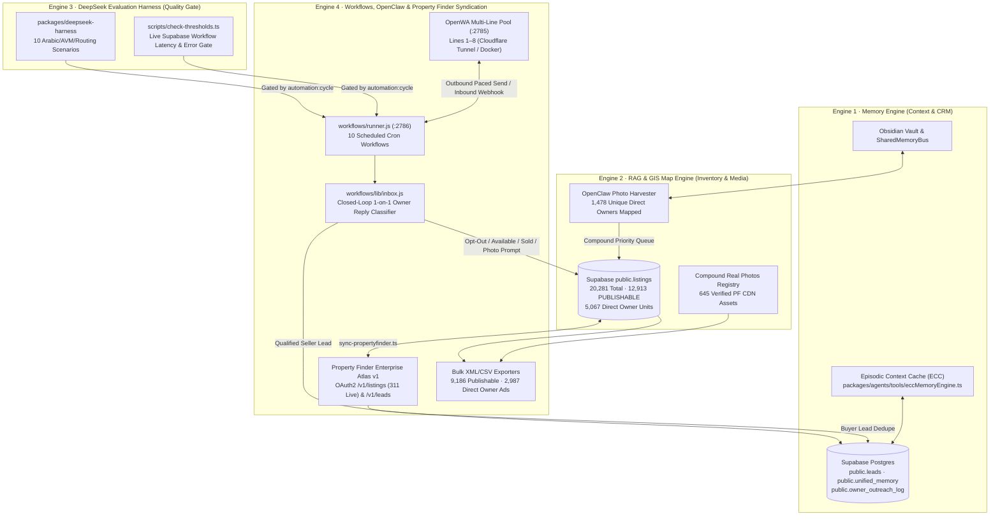

# Sierra Estates — 4-Engine Revenue & Automation Architecture

This document defines the unified **4-Engine Revenue System** operating inside [`Sierra-Estates`](https://github.com/afawzy886619888866-cloud/Sierra-Estates.git), connecting **Supabase** (`https://gaxfqcietzoonlmatiot.supabase.co`), the **Docker / Local Workflow Control Plane** (`:2786`), the **8-Line OpenWA Gateway Pool** (`:2785`), **Property Finder Enterprise Atlas v1** (`https://atlas.propertyfinder.com/v1`), **OpenClaw**, and **DeepSeek Harness**.

---

## 1. Unified 4-Engine Topology

---

## 2. Engine Responsibilities & Entry Points

| Engine | Core Modules | Primary Responsibility | CLI / CI Command |
|---|---|---|---|
| **1. Memory Engine** | `packages/memory-engine`, `packages/obsidian`, `packages/agents/tools/eccMemoryEngine.ts` | Episodic price-drop tracking, buyer/seller entity graph, Obsidian vault persistence, and Supabase `public.leads` (`652+` leads) + `public.unified_memory` synchronization. | `pnpm write-memory` |
| **2. RAG & GIS Map Engine** | `apps/sierra-estates-realty/app/api/inventory/route.ts`, `compound-real-photos.json`, `scripts/openclaw-task-runner.ts` | Serves geocoded `PUBLISHABLE` units, maps `645` verified compound photos, and prioritizes `1,478` Direct Owners missing unit photos by New Cairo compound demand. | `pnpm harvest:photos` |
| **3. DeepSeek Harness** | `packages/deepseek-harness`, `scripts/run-harness.ts`, `scripts/check-thresholds.ts` | Evaluates 10 real-estate reasoning scenarios (Cairo AVM, Arabic lead intent, contract terms, arbitrage) and enforces live Supabase workflow error-rate (`<25%`) and queue-depth (`<250`) gates. | `pnpm run-harness && pnpm check-thresholds` |
| **4. Workflows, OpenClaw & PF Ads** | `workflows/runner.js`, `workflows/01..10`, `packages/property-finder-api`, `scripts/sync-propertyfinder.ts` | Executes the 10-workflow WhatsApp/Sheets/Supabase loop (`10:00–20:00 Africa/Cairo`), classifies inbound owner replies, and syndicates ads + ingests buyer leads from Property Finder Atlas v1. | `pnpm automation:cycle` |

---

## 3. AWS EC2 Decommission & Docker Control Plane

- **Retired Infrastructure**: Legacy AWS EC2 host (`54.89.162.250`) is decommissioned across GitHub Actions (`.github/workflows/whatsapp-outreach.yml`, `.github/workflows/ec2-automations.yml` schedule disabled) and operational scripts (`scripts/verify-full-stack.ts`, `scripts/activate-production-agents.mjs`).
- **Active Control Plane**:
  - **Containerized Stack**: `infra/docker-compose.rag-station.yml` (`whatsapp-rag-station:2785` + `cloudflared`) paired with `infra/docker-compose.runner.yml` (`sierra-workflow-runner:2786`, `RUNNER_LABEL=docker-runner`).
  - **GitHub Actions Cloud Execution**:
    - `.github/workflows/whatsapp-outreach.yml` — Scheduled every 30 minutes (`08:00–18:00 UTC` / `10:00–20:00 Africa/Cairo`), defaulting to safe `WF_DRY_RUN=true` unless repository variable `WHATSAPP_LIVE_OUTREACH=true` is explicitly enabled.
    - `.github/workflows/agent-fleet.yml` — Daily scheduled & manual workflow running backend policy gates, `briefing:daily`, `automation:cycle`, `sync-propertyfinder`, `export:propertyfinder`, `pf:publish:owners`, and `check-thresholds`.

---

## 4. Closed-Loop Owners Workflow (`workflows/09` + `workflows/lib/inbox.js`)

1. **Outbound Acquisition (`workflows/09-owner-outreach/outreach.js`)**:
   - Reads the Master Inventory Sheet (`gviz` CSV) + Supabase `owner_outreach_log` + local opt-out ledger (`.state/owner-outreach-optouts.jsonl`).
   - Splits traversal across ready OpenWA lines (`line-1..line-8`) within `10:00–20:00 Africa/Cairo` (`WF_OUTREACH_ACTIVE_HOURS=10-20`), enforcing daily caps and 45–55s human pacing.
2. **Inbound Classification (`workflows/lib/inbox.js` & `/api/whatsapp/webhook`)**:
   - `opt_out` (`"إلغاء"` / `"STOP"`): Immediately suppressed in `.state/owner-outreach-optouts.jsonl`.
   - `available` (`"متاحة"`): Marks `public.listings.status = 'available'`, upserts a `qualified` seller lead in `public.leads`, and enqueues an Arabic photo-harvest request in `public.whatsapp_queue` if the listing has `<3` photos.
   - `unavailable` (`"اتباعت"` / `"غير متاحة"`): Marks `public.listings.status` as `sold` or `off-market`.
   - Inbound 1-on-1 owner media attachments route through `/api/whatsapp/webhook` (`owner-media-harvest`) to attach verified unit photos.

---

## 5. Property Finder Enterprise Atlas v1 & Feed Syndication

- **Live Atlas REST Integration (`packages/property-finder-api` & `scripts/sync-propertyfinder.ts`)**:
  - Authenticates via `POST https://atlas.propertyfinder.com/v1/auth/token` using `PROPERTY_FINDER_API_KEY` and `PROPERTY_FINDER_API_SECRET` (with 60-second safety refresh buffer).
  - Pulls live `/v1/listings` and `/v1/leads`, deduplicating incoming portal leads into Supabase `public.leads` via `pf_lead_id`.
- **Canonical Dynamic Feed (`/api/feeds/property-finder`)**:
  - Serves strictly `publish_status = 'PUBLISHABLE'` active priced listings (`RS`/`RR`/`CS`/`CR`, `EGP`, bilingual EN/AR titles & descriptions).
- **Offline / Operator Bulk Exports (`docs/drafts/propertyfinder/`)**:
  - `pnpm export:propertyfinder` → Exports all `9,186+` priced `PUBLISHABLE` listings + compact `<5 MB` `propertyfinder-feed.xml`.
  - `pnpm pf:publish:owners` → Exports `2,987+` available Direct Owner listings (`propertyfinder-owners-full.xml` / `.csv`) and generates `propertyfinder-owners-missing-photos.csv` for OpenClaw photo harvesting.
