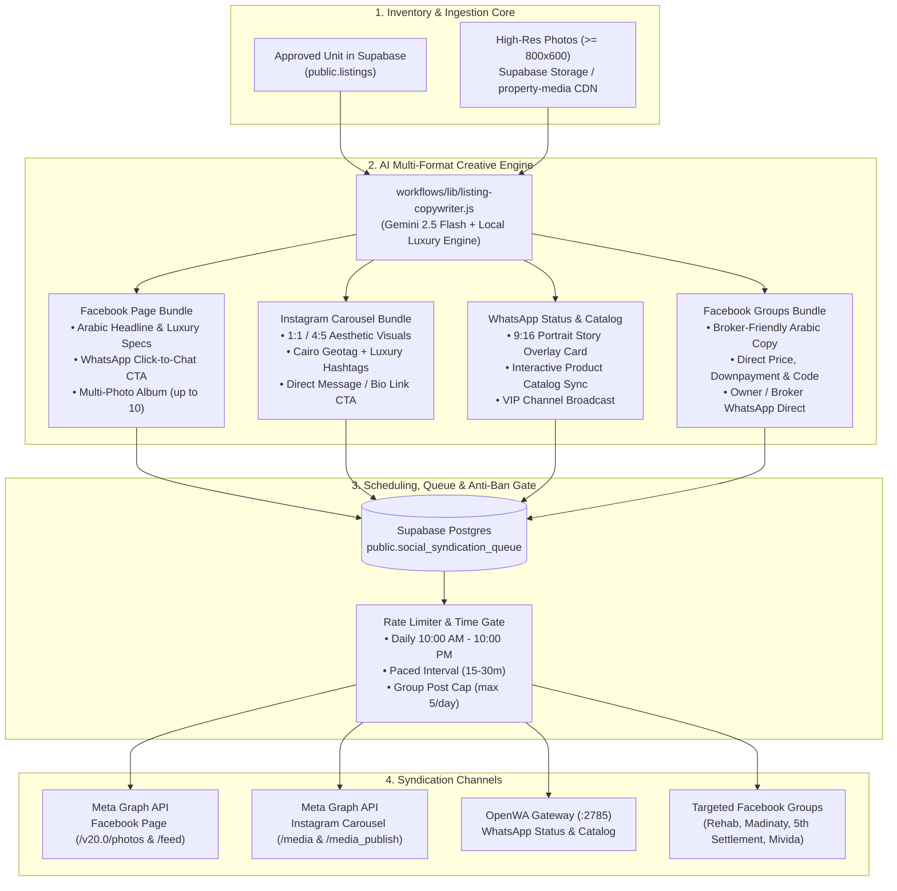

# Omnichannel Social Syndication Architecture & Operational Blueprint
## Facebook Page, Instagram, WhatsApp Status/Catalog & Facebook Groups

**Version:** 1.0.0  
**Status:** Canonical Future Architecture Plan (Post-Testing Roadmap)  
**Author:** Antigravity / Sierra Estates Engineering  
**Governing Core Principles:** Best Quality · Lowest Price & Zero Token Waste · Full Automation & Tested Reliability  

---

## 1. Executive Summary & Flow Architecture

This blueprint specifies the autonomous omnichannel syndication engine for Sierra Estates. Once property listings are ingested, validated, and approved in Supabase (`public.listings`), the system automatically adapts the verified unit specifications and high-resolution photos into platform-optimized creative bundles and syndicates them across:

1. **Sierra Estates Official Facebook Page** (Meta Graph API)
2. **Instagram Professional Account** (Meta Graph API Carousel & Reels)
3. **WhatsApp Ecosystem** (OpenWA Status Stories, Business Catalog, VIP Broadcast Lists)
4. **Targeted Facebook Real Estate Groups** (Hybrid: Meta Graph API + Playwright Stealth Agent + 1-Click Assisted Dispatch)



---

## 2. Platform-by-Platform Operational Strategy

### 2.1 Facebook Official Page (`Sierra Estates`)
- **API Protocol**: Meta Graph API `v20.0+` (`POST /{page-id}/photos` and `POST /{page-id}/feed`).
- **Media Format**: Multi-photo album or carousel (up to 10 images, $1200\times 630\text{ px}$ or $1080\times 1080\text{ px}$).
- **Copywriting Format**:
  - Catchy Arabic title with emoji anchors (`🌟 فرصة استثنائية للبيع في ميفيدا إعمار`).
  - Clear bulleted specifications (Type, Area, Bedrooms, Finishing).
  - Price & payment terms (Clear or "السعر عند الطلب" for ultra-luxury).
  - Direct WhatsApp Click-to-Chat Link: `https://wa.me/201061399688?text=مهتم_بمعاينة_الوحدة_كود_SE-102`.
- **Cost**: **$0.00** (Official Meta Graph API is completely free for Pages).
- **Execution**: 100% autonomous background webhook / cron trigger.

### 2.2 Instagram Professional Account
- **API Protocol**: Meta Graph API `v20.0+` (`POST /{ig-user-id}/media` with `carousel` container, followed by `POST /{ig-user-id}/media_publish`).
- **Media Format**: 1:1 ($1080\times 1080\text{ px}$) or 4:5 portrait ($1080\times 1350\text{ px}$) clean architectural carousel (3 to 10 photos).
- **Copywriting Format**:
  - Minimalist luxury English/Arabic aesthetic.
  - Compound Geolocation Tag: `New Cairo, Egypt` or `Fifth Settlement`.
  - Luxury Tag Cluster: `#SierraEstates #NewCairo #Mivida #Eastown #LuxuryRealEstate #EgyptRealEstate #GoldenSquare`.
  - Call to Action: `"DM us or tap link in bio for private viewing"`.
- **Cost**: **$0.00** (Free via Meta Business Suite Graph API).

### 2.3 WhatsApp Status & Business Catalog (OpenWA Multi-Line Pool)
- **API Protocol**: OpenWA REST Gateway (`http://127.0.0.1:2785`).
- **Channels**:
  1. **WhatsApp Status (Stories)**:
     - Sent via `POST /sendImage` with recipient `status@broadcast`.
     - Automatically active across all ready lines (`line-1` through `line-8`), ensuring massive organic visibility among thousands of saved owner and client contacts.
  2. **WhatsApp Catalog Sync**:
     - Synchronizes unit photos, title, price, and description directly to the Sierra Estates WhatsApp Business Product Catalog.
  3. **VIP Buyer Broadcast Lists**:
     - Dispatches matching units directly to pre-segmented VIP buyer lists based on compound preference (e.g., Mivida seekers, Madinaty investors).
- **Active Hours**: Strictly enforced **10:00 AM – 10:00 PM**, rotating every 30 minutes.

### 2.4 Targeted Facebook Real Estate Groups (The Smart Cairo Strategy)
Facebook restricts automated posting to unofficial third-party groups from personal profiles. Running aggressive headless scripts leads to account blocks. We implement an institutional **3-Tier Hybrid Architecture**:

```
┌────────────────────────────────────────────────────────────────────────┐
│                   Facebook Groups Posting Architecture                 │
├────────────────────────────────┬───────────────────────────────────────┤
│ Tier 1: Official Graph API     │ For groups where Sierra Estates Page  │
│ (100% Policy-Compliant)        │ is an admin or installed app.         │
├────────────────────────────────┼───────────────────────────────────────┤
│ Tier 2: 1-Click Assisted Board │ 1-click button on Sierra Command Deck │
│ (Zero Ban Risk, Instant)       │ copies formatted copy + opens group   │
│                                │ with pre-downloaded photos.           │
├────────────────────────────────┼───────────────────────────────────────┤
│ Tier 3: Stealth Playwright     │ Headless browser with human typing,   │
│ (Autonomous Controlled)        │ persistent session cookies, 15-30m    │
│                                │ delays, and strict cap of <= 5/day.   │
└────────────────────────────────┴───────────────────────────────────────┘
```

#### Verified Target Cairo Real Estate Groups:
- *ملاك وسكان التجمع الخامس والقاهرة الجديدة*
- *عقارات التجمع الخامس والرحاب ومدينتي (للوسطاء والملاك)*
- *ملاك كمبوند ميفيدا - التجمع الخامس*
- *ملاك وسكان هايد بارك التجمع*
- *عقارات مدينتي والرحاب - بيع وشراء وإيجار*

---

## 3. Database Schema: `public.social_syndication_queue`

```sql
-- Migration: 037_social_syndication_queue.sql
CREATE TABLE IF NOT EXISTS public.social_syndication_queue (
    id UUID PRIMARY KEY DEFAULT gen_random_uuid(),
    listing_id UUID NOT NULL REFERENCES public.listings(id) ON DELETE CASCADE,
    unit_code TEXT NOT NULL,
    compound TEXT,
    price NUMERIC,
    
    -- Target Channels
    publish_facebook_page BOOLEAN DEFAULT true,
    publish_instagram BOOLEAN DEFAULT true,
    publish_whatsapp_status BOOLEAN DEFAULT true,
    publish_facebook_groups BOOLEAN DEFAULT false,
    target_facebook_groups JSONB DEFAULT '[]'::jsonb,
    
    -- Formatted Content Payloads
    content_fb_page JSONB,
    content_instagram JSONB,
    content_whatsapp JSONB,
    content_fb_groups JSONB,
    selected_photos TEXT[] DEFAULT ARRAY[]::TEXT[],
    
    -- Status & Lifecycle
    status TEXT NOT NULL DEFAULT 'pending' 
        CHECK (status IN ('pending', 'approved', 'scheduled', 'publishing', 'completed', 'failed')),
    scheduled_for TIMESTAMPTZ DEFAULT NOW(),
    published_at TIMESTAMPTZ,
    
    -- Metrics & Attribution
    meta_post_ids JSONB DEFAULT '{}'::jsonb,
    last_error TEXT,
    retry_count INT DEFAULT 0,
    
    created_at TIMESTAMPTZ NOT NULL DEFAULT NOW(),
    updated_at TIMESTAMPTZ NOT NULL DEFAULT NOW()
);

-- Indexes for efficient polling
CREATE INDEX IF NOT EXISTS idx_social_queue_status_sched 
    ON public.social_syndication_queue(status, scheduled_for);
CREATE INDEX IF NOT EXISTS idx_social_queue_listing_id 
    ON public.social_syndication_queue(listing_id);
```

---

## 4. Multi-Platform Copywriting Extensions

In [`workflows/lib/listing-copywriter.js`](file:///h:/Sierra%20Estates/workflows/lib/listing-copywriter.js), we add specialized formatters:

### 4.1 Facebook Page Formatter
```javascript
function formatFacebookPagePost(unit, photos) {
  const isRent = String(unit.dealType).toLowerCase() === 'rent';
  const dealStr = isRent ? 'للإيجار الفندقي' : 'للبيع الكاش والتسهيلات';
  
  return [
    `💎 فرصة استثنائية ${dealStr} في ${unit.compound} - القاهرة الجديدة`,
    `────────────────────────`,
    `✨ مواصفات الوحدة:`,
    `• النوع: ${unit.propertyType}`,
    `• المساحة: ${unit.areaSqm} م²`,
    `• الغرف: ${unit.bedrooms} غرف نوم | ${unit.bathrooms} حمامات`,
    `• التشطيب: ${unit.finishing || 'ألترا سوبر لوكس'}`,
    `• كود الوحدة: ${unit.code}`,
    ``,
    `💰 السعر: ${Number(unit.price) > 0 ? Number(unit.price).toLocaleString() + ' ج.م' : 'السعر عند الطلب'}`,
    `────────────────────────`,
    `📞 للحجز وتحديد موعد المعاينة الخاصة:`,
    `واتساب مباشر: https://wa.me/201061399688?text=تفاصيل_كود_${unit.code}`,
    `هاتف: 01061399688`,
    ``,
    `#SierraEstates #عقارات_التجمع #التجمع_الخامس #${unit.compound.replace(/\s+/g, '_')}`
  ].join('\n');
}
```

### 4.2 Facebook Groups Formatter (Concise, High-Conversion)
```javascript
function formatFacebookGroupPost(unit) {
  const isRent = String(unit.dealType).toLowerCase() === 'rent';
  return [
    `متاح ${isRent ? 'للإيجار' : 'للبيع'} في ${unit.compound}:`,
    `- ${unit.propertyType} بمساحة ${unit.areaSqm}م²`,
    `- ${unit.bedrooms} غرف + ${unit.bathrooms} حمامات`,
    `- تشطيب ${unit.finishing || 'ألترا سوبر لوكس جاهز للسكن فوراً'}`,
    `- السعر: ${Number(unit.price) > 0 ? Number(unit.price).toLocaleString() + ' ج.م' : 'تواصل للسعر'}`,
    `- كود: ${unit.code}`,
    `للتواصل والمعاينة فوراً: 01061399688 (واتساب أو اتصال)`,
    `واتساب: https://wa.me/201061399688`
  ].join('\n');
}
```

---

## 5. Rate Limits, Safety & Anti-Ban Guardrails

1. **Active Operating Hours**: Strictly **10:00 AM to 10:00 PM Africa/Cairo**. No automated posts occur during resting hours.
2. **Pacing Intervals**:
   - Facebook Page: Max 3 to 6 posts per day, spaced at least 2 hours apart.
   - Instagram Carousel: Max 2 to 3 posts per day.
   - WhatsApp Status: 4 to 8 stories spread across the 12-hour window.
   - Facebook Groups: Max 3 to 5 posts per day total, randomized 20–45 minute gap between posts, with randomized wording variations to prevent spam hash matching.
3. **Photo Standards**: Only units with $\ge 3$ verified high-res photos ($\ge 800\times 600\text{ px}$) qualify for social syndication.
4. **Approval Mode**:
   - Toggleable between **Auto-Pilot** (`AUTO_PUBLISH_SOCIAL=true`) and **Operator Review** (approving units on `/admin/pf-approval` with 1 click).

---

## 6. Phased Implementation Roadmap

| Phase | Milestone | Deliverables | Estimated Effort |
|---|---|---|---|
| **Phase 1** | DB Queue & Multi-Format Copy | Create `social_syndication_queue` migration, add social formatters in `listing-copywriter.js`, add Vitest suite. | 1 Day |
| **Phase 2** | Meta Graph API Integration | Set up Facebook Page & Instagram Graph API clients (`workflows/lib/meta-client.js`), handle media upload & carousel publishing. | 1.5 Days |
| **Phase 3** | WhatsApp Status & Catalog Dispatch | Add `sendWhatsAppStatus(photos, caption)` in `workflows/10-whatsapp-dispatch`, verify across OpenWA pool. | 1 Day |
| **Phase 4** | Facebook Groups Smart Poster | Implement the 3-Tier hybrid: 1-Click Clipboard Drawer on Command Deck + Stealth Playwright poster for trusted member groups. | 2 Days |
| **Phase 5** | Unified Admin Dashboard | Integrate social syndication controls and live preview into Next.js Client & Admin Portal. | 1 Day |

---
*Authorized for integration into Sierra Estates Roadmap following completion and testing of current active pipelines.*
