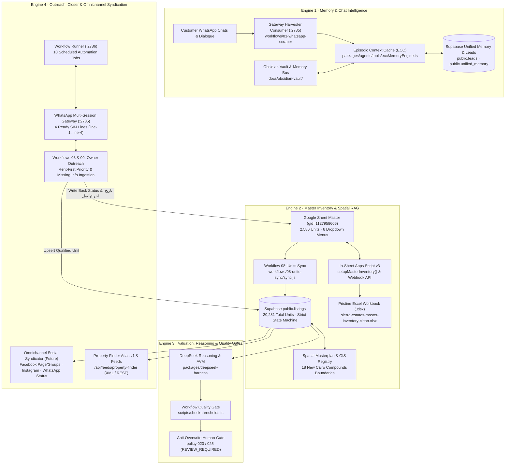
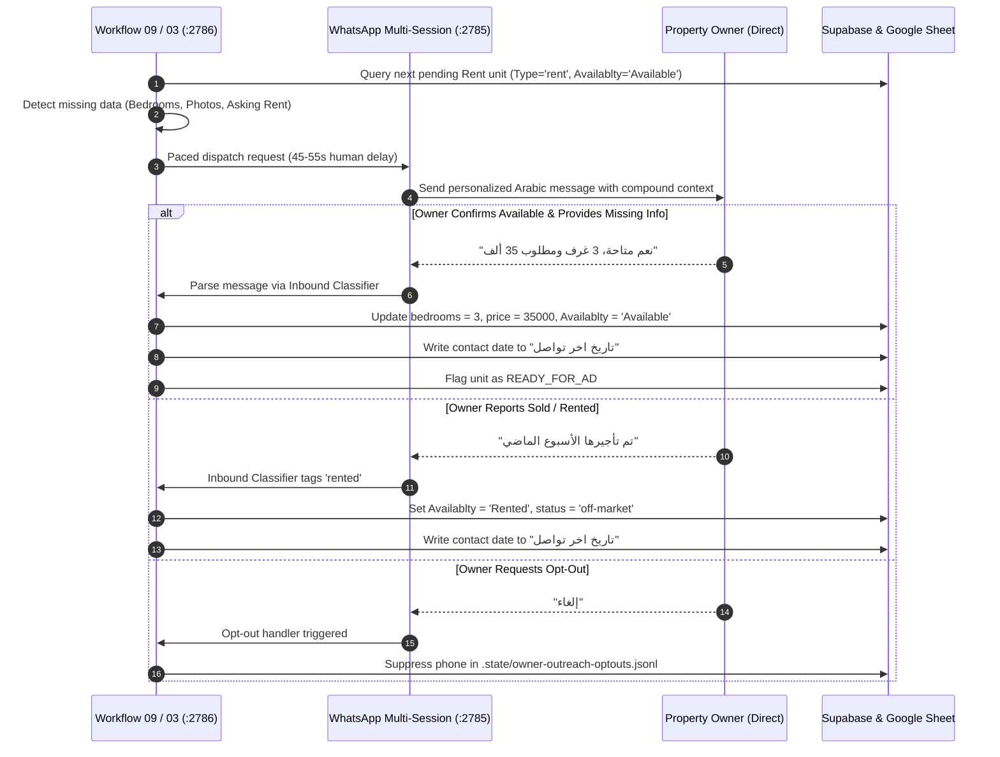
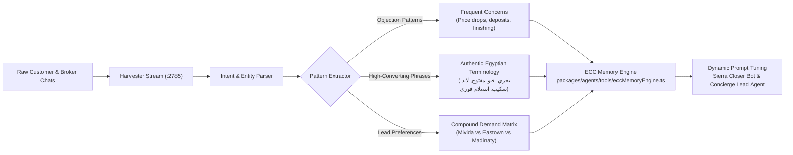
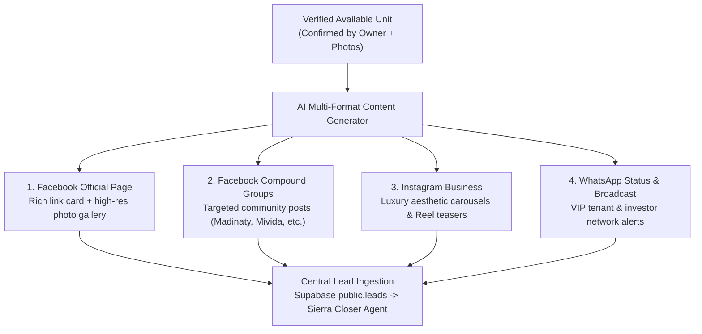

# Sierra Estates — Repository Automation & Workflow Master Plan

> **Authoritative Technical Specification & Operational Blueprint**  
> **Unified Version**: 2026.4 (Master Ingestion, WhatsApp Outreach, Chat Learning & Omnichannel Syndication)  
> **Branch**: `main` · **Repository**: [`afawzy886619888866-cloud/Sierra-Estates`](https://github.com/afawzy886619888866-cloud/Sierra-Estates.git)

---

## 1. Executive Summary & Architecture Topology

The **Sierra Estates Automation & Workflow Engine** is an integrated PropTech operations platform engineered specifically for the New Cairo real estate market. It combines an authoritative **Supabase PostgreSQL** backend, an automated **Google Sheets / Excel master inventory ingestion pipeline**, a 4-line **WhatsApp Multi-Session Gateway**, an **Owner Rent-First Verification Workflow**, a **Chat Learning Intelligence Engine**, and an automated **Property Finder / Omnichannel Ad Syndicator**.



---

## 2. Master Inventory & Google Sheets Ingestion Pipeline

### 2.1 The Authoritative Schema (19 Canonical Columns)
The master inventory operates on a strict 19-column contract matching both the live Google Sheet (`gid=1127958606`) and the standalone Excel workbook:

| Col # | Header Name | Type / Validation | Operational Role |
|---|---|---|---|
| **A** | `Timestamp` | Text / ISO Date | Record creation or intake timestamp |
| **B** | `NO` | Integer | Sequential record index |
| **C** | `تاريخ اخر تحديث ` | Text / Date | Last sheet modification date |
| **D** | `Name` | Text | Owner or representative name |
| **E** | `Mobile` | String (`@` Text) | Formatted phone number (zero-drop protection) |
| **F** | `Availablty` | **Dropdown (8 choices)** | Lifecycle status: `Available`, `Follow up`, `تم استلام الوحدة`, `Sold`, `Rented`, `No answer`, `Not available`, `Ask Owner` |
| **G** | `bedrooms` | **Dropdown (9 choices)** | `Studio`, `1`, `2`, `3`, `4`, `5`, `6+`, `Commercial / Retail`, `Ask Owner / Unknown` |
| **H** | `Location ` | **Dropdown (31 choices)** | 30+ New Cairo compounds + `Other / To Be Added` + `Ask Owner / Under Review` |
| **I** | `Unit Price` | Numeric (`#,##0`) | Asking price or monthly rent in EGP/USD |
| **J** | `Furnished or not` | **Dropdown (6 choices)** | `Furnished`, `Unfurnished`, `Semi-Furnished`, `Ultra Super Lux`, `Core & Shell`, `Ask Owner` |
| **K** | `Type` | **Dropdown (5 choices)** | `rent`, `sale`, `commercial rent`, `commercial sale`, `Ask Owner` |
| **L** | `Property Tybe` | **Dropdown (11 choices)** | `Apartment`, `Standalone Villa`, `Twin House`, `Townhouse`, `Duplex`, `Penthouse`, `Studio`, `Chalet`, `Commercial / Office`, `Clinic`, `Floor With Garden` |
| **M** | `Code` | String | Unique unit code (e.g. `MT-B14-3U-8.34M`, `ONN170`) |
| **N** | `Owner` | Text | Entity type (`Owner`, `Direct Owner`, `Broker`) |
| **O** | `Garden` | Text / Numeric | Garden area in sqm or `Yes`/`No` |
| **P** | `Space` | Text | Unit built-up area (e.g. `108 m²`) |
| **Q** | `Pool` | Text | Private/shared pool availability |
| **R** | `Comment` | Text | Owner notes, finishing specs, payment terms |
| **S** | `تاريخ اخر تواصل` | Text / Date | **Automated Outreach Stamp**: Set by WhatsApp bot upon each verified contact |

---

### 2.2 Data Cleaning & Normalization Rules
The ingestion engine normalizes all legacy entries automatically:

1. **Compound Name Normalization (1,138 rows standardized)**:
   - `Mevida` / `mevida` $\to$ `Mivida`
   - `rehab` / `al rehab` / `الرحاب` $\to$ `Al Rehab`
   - `madinaty` / `مدينتي` $\to$ `Madinaty`
   - `east town` / `eastown` $\to$ `Eastown`
   - `fifth square` / `fifth sq` $\to$ `Fifth Square`
   - `up town cairo` / `uptown` $\to$ `Uptown Cairo`
   - `cfc` / `cairo festival city` $\to$ `Cairo Festival City (CFC)`
   - `hyde park` / `hydepark` $\to$ `Hyde Park`
   - `villette` $\to$ `Villette`
   - `5th settlement` / `fifth settlement` / `new cairo` $\to$ `New Cairo (General)`
   - `lake view` / `lakeview` $\to$ `Lake View Residence`
   - `sodic` / `sodic east` $\to$ `SODIC East`
   - `swan lake` / `swanlake` $\to$ `Swan Lake`
   - `palm hills` $\to$ `Palm Hills New Cairo`
   - `waterway` / `the waterway` $\to$ `Waterway`
   - `mountain view` / `mv` $\to$ `Mountain View iCity`
   - `zed` / `zed east` $\to$ `Zed East`
   - `galleria` / `galleria moon valley` $\to$ `Galleria Moon Valley`
   - `oriana` / `oriana 2` $\to$ `Oriana 2`
   - Blank or unrecognized values $\to$ `Other / To Be Added` or `Ask Owner / Under Review`

2. **Room & Misplaced Price Recovery (747 rows repaired)**:
   - **Misplaced Prices**: If a large number ($\ge 5,000$, such as `80000` rent) was entered into `bedrooms`, it is automatically transferred to `Unit Price` (if price was empty), and `bedrooms` is defaulted to `Ask Owner / Unknown`.
   - **Comment Extraction**: If bedrooms is blank, the engine scans the Arabic comment using regex `(\d+)\s*(غرف|غرفه|غرفة|نوم|bed|bhk)` to recover counts like `3 غرف` $\to$ `3`.
   - **Fallback**: All remaining unresolved units are assigned `Ask Owner / Unknown` so the WhatsApp bot prompts the owner directly.

3. **Leading Zero Phone Protection**:
   - `Mobile` is explicitly set to Plain Text (`@`), preventing Excel or Google Sheets from dropping leading zeroes (`010...` or `011...`).

---

### 2.3 Delivery Mechanisms: In-Sheet Script & Standalone Excel

1. **In-Sheet 1-Click Apps Script (`scripts/google_apps_script_master.js`)**:
   - Function `setupMasterInventory()` applies header styling (`#0F172A`), column widths, frozen row 1, auto-filters, 6 dropdown rules, and in-place normalization in one execution.
   - Installs interactive Google Sheets menu: **`⚡ Sierra Estates Automation`**.
   - Serves as the write-back webhook for background workers.
2. **Standalone Pristine Excel Workbook (`scripts/build_clean_master_workbook.py`)**:
   - Generates [`apps/sierra-estates-realty/public/downloads/sierra-estates-master-inventory-clean.xlsx`](file:///h:/Sierra%20Estates/apps/sierra-estates-realty/public/downloads/sierra-estates-master-inventory-clean.xlsx).
   - Houses options in a dedicated `_ValidationLookups` worksheet, bypassing Excel's 255-character validation formula limit.

3. **Supabase Sync Daemon (`workflows/08-units-sync/sync.js`)**:
   - Probes existing listings by both `code` and `dupe_check_hash`.
   - Protects human verification stamps: never overwrites `verified_at`, `verified_by`, or `publish_status`.
   - Prevents Postgres state machine violations by storing raw status in `availability` and preserving strict `REVIEW_REQUIRED` intake states.

---

## 3. Owner Outreach & Verification Engine (Rent-First Focus)

### 3.1 Rent Ingestion Priority
Rental inventory features higher market turnover and fast-moving demand in New Cairo. The outreach engine filters for rental records (`Type = 'rent'` or `deal = 'Rent'`) that are pending verification:



### 3.2 Dynamic Arabic Message Template with Missing-Info Inquiries
When a unit has missing attributes, the bot adapts its message dynamically:

```text
السلام عليكم ورحمة الله وبركاته يا فندم،

مع حضرتك فريق إدارة العمليات بـ Sierra Estates بالتجمع الخامس.
نتواصل مع سيادتكم بخصوص عقاركم المعروض للإيجار في كمبوند {COMPOUND} (كود الوحدة: {CODE}).

لدينا عملاء مهتمون بالتنفيذ الفوري في نفس النطاق السعري، ونود التأكد من:
1. هل الوحدة ما زالت متاحة للإيجار؟
2. {MISSING_ROOMS_OR_PRICE_PROMPT}
3. هل متوفر صور حديثة للوحدة لمعاينتها للعميل؟

شاكرين جداً لحضرتك، ونتمنى لحضرتكم دوام التوفيق 🤝
(لعدم استقبال رسائل أخرى، أرسل كلمة "إلغاء")
```

---

## 4. WhatsApp Chat Learning & Client Intelligence Engine

### 4.1 Safe Chat Harvesting Architecture
Running multiple standalone WhatsApp Web instances on the same phone numbers carries severe ban risks. Sierra Estates uses a zero-ban **Gateway Harvester Consumer** architecture:

1. **Multi-Session Gateway (`:2785`)**:
   - Manages 4 authenticated physical lines (`line-1` through `line-4`).
   - Maintains WebSocket connections with WhatsApp Web without Puppeteer duplication.
2. **Harvester Consumer (`workflows/01-whatsapp-scraper/index.js`)**:
   - Consumes the `/api/harvester/recent` HTTP stream from the gateway.
   - Extracts real-time broker group chatter, buyer requests, and owner replies in memory.
   - Completely avoids second-session login collisions.

### 4.2 Conversational AI Learning Loop
The harvested conversations feed directly into the **Episodic Context Cache (ECC)** and **Sierra Closer Bot**:



- **Objection Handling**: The bot analyzes actual dialogues where human agents successfully addressed price resistance or payment term negotiations, automatically refining its counter-offers.
- **Linguistic Authenticity**: Eliminates rigid literal translations, replacing them with standard Egyptian real estate jargon (`وايد جاردن`, `نص مفروش`, `تشطيب الترا سوبر لوكس`, `كود الوحدة`).

---

## 5. Property Finder Ad Syndication & Feeds

### 5.1 Ad Generation Specification
Once a unit is marked available with verified data (photos, compound, rooms, rent), the system generates bilingual marketing ad assets complying with the Property Finder Enterprise Atlas v1 standard:

1. **Title Formula**:
   - *English*: `[Bedrooms] Bed [Property Type] for Rent in [Compound], New Cairo`
   - *Arabic*: `[نوع العقار] [عدد الغرف] غرف للإيجار في كمبوند [الكمبوند] - التجمع الخامس`
2. **Description Structure**:
   - **Hook**: Key luxury highlight (e.g. wide garden view, prime corner location).
   - **Key Specs**: BUA, floor level, furnishing status, bathrooms, kitchen appliances.
   - **Compound Amenities**: Clubhouses, lakes, proximity to AUC / Road 90.
   - **Financial Terms**: Monthly rent, deposit terms, payment frequency.
   - **Call to Action**: Sierra Estates advisory contact with direct WhatsApp link.

### 5.2 Dynamic Feed & Bulk Export Paths
- **Real-Time XML Feed**: Accessible at `/api/feeds/property-finder` for live crawler syndication.
- **Atlas v1 REST API**: Pushes listings directly via `POST /v1/listings` using `PROPERTY_FINDER_API_KEY` and `PROPERTY_FINDER_API_SECRET`.
- **Bulk CSV / XML Exporters**:
  - `pnpm export:propertyfinder` $\to$ Generates `propertyfinder-feed.xml` (`<5 MB` chunked).
  - `pnpm pf:publish:owners` $\to$ Generates `propertyfinder-owners-full.xml` for verified direct owner listings.

---

## 6. Omnichannel Social Syndication Plan (Future Rollout)

Following full verification and testing of the owner outreach flow, the platform will activate the automated social syndication engine:



- **Architectural Reference**: Detailed channel specifications, API authentication, rate limits, and scheduling policies are defined in [`docs/OMNICHANNEL_SOCIAL_SYNDICATION_PLAN.md`](docs/OMNICHANNEL_SOCIAL_SYNDICATION_PLAN.md).

---

## 7. Operational Workflow Fleet (The 10 Background Jobs)

All 10 workflows are orchestrated via `workflows/runner.js` on port `2786`:

| Workflow ID | Module Name | Primary Responsibility | Schedule / Trigger |
|---|---|---|---|
| **01** | `whatsapp-scraper` | Safe HTTP consumption of broker groups chatter via port 2785 harvester | Continuous / Hourly |
| **02** | `owner-search` | Identifies potential direct owner listings from ingested broker streams | Every 2 hours |
| **03** | `owner-contact` | Initial outreach to newly discovered owners via WhatsApp session pool | `10:00–20:00` Cairo time |
| **04** | `email-sender` | Sends PDF investor memos and verified lease drafts to qualified clients | On-Demand / Lead Event |
| **05** | `unit-adder` | Automated intake of structured listing data into Supabase `public.listings` | Webhook / Hourly |
| **06** | `gateway-sentinel` | Health checker for all 4 WhatsApp lines, alerting on QR disconnects | Every 5 minutes |
| **07** | `daily-digest` | Synthesizes daily outreach metrics, verified units, and leads for management | `21:00` Cairo time |
| **08** | `units-sync` | Bidirectional sync between Google Sheet `gid=1127958606` and Supabase | Hourly / Manual trigger |
| **09** | `owner-outreach` | Paced follow-up and verification loop for rental and resale units | `10:00–20:00` Cairo time |
| **10** | `whatsapp-dispatch` | Paced outbound queue worker enforcing 45–55s human delays | Continuous Queue Worker |

---

## 8. Live System Ports & Monitoring Dashboard

| Service | Port | Endpoint | Purpose | Health Check |
|---|---|---|---|---|
| **Amphion Command Deck** | `8888` | `http://127.0.0.1:8888` | Kanban boards, milestone contract tracking & memory events | `GET /api/state` $\to$ `200 OK` |
| **WhatsApp Multi-Session** | `2785` | `http://127.0.0.1:2785` | 4 WhatsApp Web sessions (`line-1`..`line-4`) with QR management | `GET /api/health` $\to$ `200 OK` |
| **Workflow Runner** | `2786` | `http://127.0.0.1:2786` | Execution engine for the 10 scheduled automation workflows | `GET /api/health` $\to$ `200 OK` |
| **Next.js Admin Console** | `3000` | `http://localhost:3000/admin` | Interactive dashboard, inventory tables & `workflow_ops` view | `pnpm type-check` $\to$ `exit 0` |

---

## 9. Immediate Action Items & Operator Guide

1. **Execute In-Sheet Setup**:
   - Open [Google Sheet gid=1127958606](https://docs.google.com/spreadsheets/d/1g9GIcCM0slC5QplgzatZRxU46O_N4CR2jgDp9DeMYZk/edit?gid=1127958606).
   - In **Extensions** > **Apps Script**, paste [`scripts/google_apps_script_master.js`](file:///h:/Sierra%20Estates/scripts/google_apps_script_master.js), save, and run `setupMasterInventory()`.
   - Toggle **General Access** to **Anyone with the link** (Editor) so background daemons can sync seamlessly.
2. **Launch Rent Verification Batch**:
   - In the Admin Portal under **Workflow Ops** (or via `http://127.0.0.1:2786`), trigger `09-owner-outreach` to begin verifying the highest-priority rent units and capturing missing details from owners.
3. **Monitor Inbound Chat Learning**:
   - Inspect incoming owner responses via the WhatsApp Gateway (`:2785`) to verify that `تاريخ اخر تواصل` and room counts are updated automatically.
