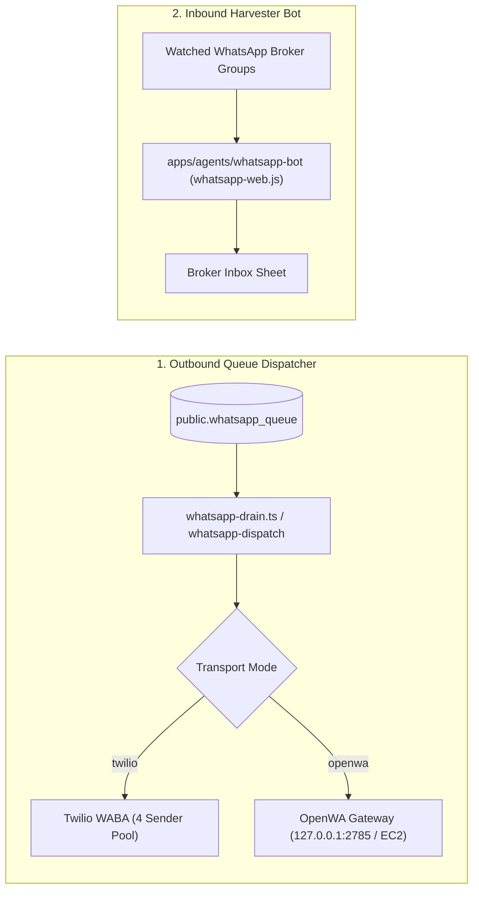

# WhatsApp Go-Live Operations Runbook
**Milestone:** SIE-107 · **Issue:** SIE-107-002  
**Date:** 2026-10-16  
**Status:** Canonical Operations Guide

---

## 1. System Architecture & Dual-Transport Model

Sierra Estates utilizes two distinct WhatsApp subsystems that MUST NOT be confused:

### Transport Isolation Rules
1. **Twilio WABA (`WHATSAPP_PROVIDER=twilio`)**:
   - Uses the 4 registered Twilio phone numbers seeded in `public.whatsapp_numbers`.
   - Enforces 40 sends/hour per number and 80 sends/day per number (max 320/day total).
2. **OpenWA Gateway (`WHATSAPP_PROVIDER=openwa`)**:
   - Relies on the self-hosted Baileys / OpenWA gateway listening on port 2785 (`http://18.232.148.172:2785` or local `http://127.0.0.1:2785`).
   - Global caps: 20/hr and 80/day default (stateless, computed from queue `sentAt`).
3. **Inbound Harvester (`infra/whatsapp-scraper`)**:
   - Independent client monitoring New Cairo real estate groups for inventory listings.

---

## 2. Dispatch Scheduling & Operating Window

- **Operating Hours:** 12:00 PM – 8:00 PM Cairo Time (`12:00–20:00 Africa/Cairo`).
- **Outreach Rate Limiting:**
  - Outside operating hours, `drainWhatsAppQueue()` immediately returns `{ skipped: 'outside-operating-hours' }`.
  - Stale in-flight claims are automatically recovered via `recoverStaleSendingJobs()` (10-minute timeout).
- **Trigger Sources:**
  - `/api/cron/dispatch/whatsapp-dispatch` (invoked via `automations.yml` or Vercel cron).
  - Piggyback trigger on `/api/cron/sync-leads` to ensure daily dispatch without consuming extra Hobby cron slots.
  - Inbound webhook opportunistic drain (~2s delayed).

---

## 3. Go-Live Activation Checklist

1. **Verify Transport Configuration:**
   - In `.env` / Vercel Environment Variables:
     - `WHATSAPP_PROVIDER`: `openwa` or `twilio`
     - `WHATSAPP_API_URL`: Gateway URL (e.g. `http://127.0.0.1:2785`)
     - `OPENWA_ADMIN_API_KEY`: Secret bearer token
2. **Gateway Pairing Procedure (OpenWA mode):**
   - Launch gateway via `start-sierra.bat` or `npm start` in `infra/whatsapp-scraper`.
   - Navigate to `http://127.0.0.1:2786/pair/qr` or request code at `POST /pair/code`.
   - Scan QR code with the official Sierra Estates device (`+201092048333`).
   - Verify connection state via `GET http://127.0.0.1:2786/api/health`.
3. **Emergency Halt:**
   - Set `system_config` table key `whatsapp_outreach` `operatingHourStart` = `operatingHourEnd` = 0 to instantly freeze dispatch.
   - Kill runner process or stop systemd service: `sudo systemctl stop se-workflow-runner`.
